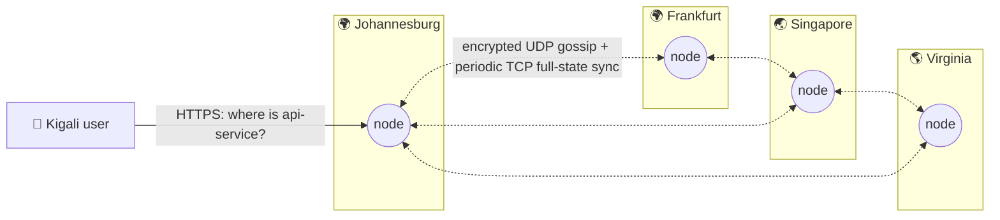

<div align="center">


# Atlas

**A distributed edge service-discovery system in Go.**
Nodes find each other through a SWIM-style gossip protocol, without a central
database or a leader. When a node dies, the rest of the cluster knows within
seconds.

[](https://github.com/manziosee/atlas/actions/workflows/ci.yml)
[](https://github.com/manziosee/atlas/actions/workflows/codeql.yml)
[](https://securityscorecards.dev/viewer/?uri=github.com/manziosee/atlas)
[](https://goreportcard.com/report/github.com/manziosee/atlas)
[](LICENSE)

</div>

---

## Live demo

A two-node Atlas cluster runs on Fly.io in Paris (`cdg`). It is a public
demo, not a production service, and its demo data may be reset at any time.

| What | Link |
|------|------|
| **Live dashboard** (connects on its own with the read-only demo token) | **[atlas-edge.fly.dev/dashboard](https://atlas-edge.fly.dev/dashboard/#token=atlas-demo-read-only-public-token-2027)** |
| Liveness | [atlas-edge.fly.dev/healthz](https://atlas-edge.fly.dev/healthz) |
| Readiness | [atlas-edge.fly.dev/readyz](https://atlas-edge.fly.dev/readyz) |
| API reference | [`api/v1/openapi.yaml`](api/v1/openapi.yaml) |

The demo token `atlas-demo-read-only-public-token-2027` is published on
purpose. It has the `read` scope only and expires on 2027-10-23, so any write
returns `403 insufficient_scope`. The dashboard keeps the token in page
memory; the link passes it in the URL fragment, which browsers never send to
the server.

Query the live cluster from a terminal:

```bash
export ATLAS=https://atlas-edge.fly.dev
export TOKEN=atlas-demo-read-only-public-token-2027

curl -s -H "Authorization: Bearer $TOKEN" $ATLAS/v1/members            # both nodes, alive
curl -s -H "Authorization: Bearer $TOKEN" "$ATLAS/v1/services?tag=demo&limit=2"
curl -s -H "Authorization: Bearer $TOKEN" "$ATLAS/v1/lookup/payments?tag=primary"
curl -sN -H "Authorization: Bearer $TOKEN" "$ATLAS/v1/events"           # live event stream; Ctrl-C to stop
```

```json
{
  "id": "demo-payments-1",
  "name": "payments",
  "node_id": "80727dc6495528",
  "address": "10.20.0.11:8443",
  "region": "cdg",
  "version": "2.3.1",
  "tags": ["demo", "primary"],
  "health": "unknown",
  "revision": 1
}
```

The `atlas-api` services are the two nodes' own HTTP APIs, registered with
real health checks, so they show as `healthy`. The `payments` and `catalog`
entries are sample records with no health check, so they stay `unknown`.
To try registration, updates and failure handling, run your own cluster with
the [walkthrough](#walkthrough-a-service-from-registration-to-failover) below.

## Table of contents

- [Live demo](#live-demo)
- [Why Atlas](#why-atlas)
- [Tech stack](#tech-stack)
- [Architecture](#architecture)
- [Security](#security)
- [Quick start](#quick-start)
- [Walkthrough: a service from registration to failover](#walkthrough-a-service-from-registration-to-failover)
- [Configuration](#configuration)
- [Deploy](#deploy)
- [Observability](#observability)
- [Project layout](#project-layout)
- [Roadmap](#roadmap)
- [Contributing](#contributing)

## Why Atlas

Picture 50 servers spread across the world. Atlas does not ask a central
database where services live. Instead, **every node learns about every other
node through gossip**:

- **No single point of failure.** There is no leader, no quorum and no
  central registry.
- **Local reads.** Every lookup is answered from the node's own memory.
- **Fast failure detection.** SWIM-style randomized probes, indirect
  `ping-req` checks, suspicion and refutation.
- **Partition tolerant.** Each region keeps working during a network split
  and converges once the network heals.

The design is inspired by systems such as HashiCorp's memberlist (Lifeguard)
and Fly.io's Corrosion. Atlas is its own implementation, written from first
principles.

## Tech stack

<table>
<tr>
<td align="center" width="110"><br/><b>Go 1.26+</b><br/><sub>core runtime</sub></td>
<td align="center" width="110"><br/><b>Docker</b><br/><sub>distroless images</sub></td>
<td align="center" width="110"><br/><b>Kubernetes</b><br/><sub>StatefulSet + Kustomize</sub></td>
<td align="center" width="110"><br/><b>Fly.io</b><br/><sub>multi-region edge</sub></td>
<td align="center" width="110"><br/><b>Prometheus</b><br/><sub>metrics + alerts</sub></td>
<td align="center" width="110"><br/><b>Grafana</b><br/><sub>dashboards</sub></td>
</tr>
<tr>
<td align="center"><br/><b>TLS 1.3 / mTLS</b><br/><sub>API transport</sub></td>
<td align="center"><br/><b>GitHub Actions</b><br/><sub>CI/CD</sub></td>
<td align="center"><br/><b>Sigstore</b><br/><sub>signed releases</sub></td>
<td align="center"><br/><b>SQLite</b><br/><sub>persistent service registry</sub></td>
<td align="center"><br/><b>gRPC</b><br/><sub>service registry API</sub></td>
<td align="center"><br/><b>AES-256-GCM</b><br/><sub>gossip encryption</sub></td>
</tr>
</table>

| Layer | Technology | Why |
|-------|-----------|-----|
| Language | **Go** (stdlib-first) | Goroutines and channels fit protocol loops; one static binary. |
| Gossip transport | **UDP** + **AES-256-GCM** | Connectionless, cheap per-peer messages; authenticated encryption. |
| Control API | **net/http** (TLS 1.3, HTTP/2) | Stdlib routing (Go 1.22+ patterns), no framework attack surface. |
| Logging | **log/slog** (JSON) | Structured logs, ready for Loki/ELK. |
| Metrics | **Prometheus client_golang** | Industry standard; private registry. |
| Containers | **Distroless static, nonroot** | No shell, no package manager, UID 65532. |
| Orchestration | **Kubernetes + Kustomize**, **Fly.io Machines** | Local → cluster → global edge. |
| Supply chain | **CodeQL, govulncheck, gitleaks, Grype, Dependabot, Scorecard, Cosign, SLSA provenance, SBOM** | Every link of the chain is checked. |

**Runtime dependencies:** Prometheus client, `golang.org/x/time`, gRPC, and
pure-Go SQLite (`modernc.org/sqlite`). The remaining application code uses the
Go standard library.

## Architecture



Each node runs the same binary with two planes:


**How failure detection works:**

1. Each node pings one random member every `PROBE_INTERVAL`.
2. If the direct ping does not get an ack during the first half of
   the current local-health-adjusted deadline, the node asks up to three other
   alive members to ping the target (`ping-req`). The helper forwards the
   target's ack back to the requester. The target is marked **suspect** only
   if neither direct nor indirect probing succeeds before that deadline.
   Missed probes raise a bounded local health score and lengthen later
   deadlines up to 9x `PROBE_TIMEOUT`; successful probes lower the score.
3. The suspicion spreads by gossip. If the suspect is alive, it **refutes** by
   raising its *incarnation number*, and the higher number always wins.
4. A suspect that does not refute within `SUSPICION_TIMEOUT` is declared
   **dead**.
5. Updates piggyback on pings and on gossip to `FANOUT` random peers, with
   periodic authenticated TCP push-pull of the full membership view every
   tenth gossip round. UDP gossip stays MTU-bounded; TCP sync accepts at most
   16 MiB per encrypted snapshot. This lets late joiners and recovering
   partitions reconcile views larger than a datagram.

The full internals are in **[docs/ARCHITECTURE.md](docs/ARCHITECTURE.md)**
(state machine, sequence diagrams, wire format). The decisions are recorded
in **[docs/adr/](docs/adr/)**.

## Security

Atlas assumes the network between regions is hostile.

| Layer | Controls |
|-------|----------|
| **Gossip** | AES-256-GCM on every datagram, with forged packets dropped *before* parsing. AAD protocol binding, a replay window (`MAX_CLOCK_SKEW`) and a rotatable keyring (1 primary + 3 decrypt-only keys). Bounded sizes and member counts. |
| **API** | TLS 1.3 only, with optional mTLS and certificate hot reload. Bearer tokens are stored as SHA-256 digests and compared in constant time. Per-IP rate limiting honors forwarded client addresses only from configured trusted proxy CIDRs. Slowloris timeouts, header/body caps and strict security headers. |
| **Config** | Fails closed: no gossip key, no tokens, weak tokens, or production without TLS each stop startup. Secrets never appear in logs. |
| **Container** | Distroless, non-root, read-only root FS, `cap_drop: ALL`, `no-new-privileges`, resource limits, ports bound to localhost in compose. |
| **Kubernetes** | Pod Security `restricted`, default-deny NetworkPolicies, no SA token, seccomp `RuntimeDefault`, PDB, topology spread. |
| **Supply chain** | CodeQL, govulncheck, gitleaks, a Grype CVE gate, Dependabot and OpenSSF Scorecard. Releases are signed with **Cosign** (keyless) and ship with an **SBOM** and **SLSA provenance**. |

The threat model, known limitations and how to report a vulnerability are in
**[SECURITY.md](SECURITY.md)**.

## Quick start

**Prerequisites:** Docker (with Compose v2), Go 1.26+ (for local builds),
OpenSSL and Bash (Git Bash works on Windows).

```bash
git clone https://github.com/manziosee/atlas && cd atlas

# 1. Create .env with freshly generated secrets (gossip key, API token, Grafana password)
./scripts/gen-secrets.sh

# 2. Start a 3-node cluster with Prometheus and Grafana
docker compose up --build -d

# 3. Ask any node about the cluster
export $(grep -E '^ATLAS_TOKEN=' .env)
docker compose exec atlas-1 atlas-cli members --addr http://127.0.0.1:8080 --token "$ATLAS_TOKEN"
```

```
ID       ADDRESS       REGION  STATE  INCARNATION    SINCE
atlas-1  atlas-1:7946  local   alive  1792277220551  42s
atlas-2  atlas-2:7946  local   alive  1792277220551  41s
atlas-3  atlas-3:7946  local   alive  1792277220550  41s
```

```bash
# 4. Break something and watch the cluster heal
./scripts/chaos.sh 3

# 5. Run the authenticated API load profile (30 seconds by default)
docker compose --profile loadtest run --rm k6

# 6. Register a demo instance and query it through DNS (requires `dig`)
curl -fsS -H "Authorization: Bearer $ATLAS_TOKEN" \
  -H 'Content-Type: application/json' \
  -d '{"name":"demo","address":"10.0.0.25:8080"}' \
  http://127.0.0.1:8081/v1/services
dig @127.0.0.1 -p 5353 demo.atlas A
dig @127.0.0.1 -p 5353 _demo._tcp.atlas SRV
```

| Service | URL |
|---------|-----|
| Node HTTP APIs | http://127.0.0.1:8081 · :8082 · :8083 |
| Node gRPC APIs | 127.0.0.1:8084 · :8085 · :8086 |
| Prometheus | http://127.0.0.1:9091 |
| Grafana | http://127.0.0.1:3000 (user `admin`, password in `.env`) |

**Turn on TLS locally:**

```bash
./scripts/gen-certs.sh                       # local CA + server/client certs
# in .env: ATLAS_TLS_ENABLED=true, ATLAS_HEALTHCHECK_ADDR=https://127.0.0.1:8080
docker compose up -d
atlas-cli members --addr https://127.0.0.1:8081 --ca deploy/certs/ca.crt
```

### Service registry API

All `/v1/*` endpoints require a bearer credential. Reads need the `read`
scope, registry changes need `write`, and `/v1/admin/*` needs `admin`, which
also grants the other two. Scoped credentials have a required RFC3339
`expires_at`, and expired credentials are rejected. The compatibility
`ATLAS_API_TOKENS` setting grants unexpiring admin credentials, so use
`ATLAS_API_CREDENTIALS` for least privilege. The full reference is
[`api/v1/openapi.yaml`](api/v1/openapi.yaml).

Each node persists its registrations in SQLite and replicates them to every
other node over gossip, so any node can answer reads. A registration belongs
to the node that accepted it: that node runs its health checks and applies its
updates. **You can still send any write to any node.** Every node gossips its
API address (`ATLAS_API_ADVERTISE_ADDR`, derived automatically when unset), so
a node that receives an update, heartbeat or delete for another node's service
forwards it to the owner with your own credential and returns the owner's
answer. The owner checks the credential again, so forwarding grants nothing
extra. If the owner is alive but not answering, the response is
`502 owner_unreachable`; if it runs an older version without an API address,
`409 not_owner` with an `owner_node` field.

| Method and path | Purpose |
|-----------------|---------|
| `POST /v1/services` | Register an instance: `name`, `address`, and optionally `id`, `version`, `tags`, plus either `health_check` or `ttl_seconds`. Send an `Idempotency-Key` header or a stable `id` to make retries safe. |
| `GET /v1/services` | List instances, 100 per page by default (`limit` up to 1000). Filter by `name`, `region`, `health`, `version`, `node_id`, and repeated `tag`. Follow `next_cursor` for more. |
| `GET /v1/services/{id}` | Read an instance. The `ETag` header is its revision. |
| `PUT /v1/services/{id}` | Create or fully replace an instance with that ID. |
| `PATCH /v1/services/{id}` | Change some fields, for example `{"draining": true}`. Send `If-Match: "<revision>"` to reject the change if someone else updated it first (`412 precondition_failed`). |
| `POST /v1/services/{id}/heartbeat` | Keep a TTL instance healthy. |
| `DELETE /v1/services/{id}` | Deregister. |
| `GET /v1/lookup/{name}` | Select one instance by routing rules (`region`, `key`, `tag`, and the per-request `stale`, `latency` and `tolerance` overrides). |
| `GET /v1/services/{id}/history` | Every recorded change to one service, newest first, even after it was deregistered. |
| `GET /v1/history?name=` | Recent changes across services, or for one service name. |
| `GET /v1/node`, `GET /v1/members` | This node, and the cluster as this node sees it. |
| `GET /v1/events` | Membership and registry events as Server-Sent Events, resumable with `Last-Event-ID`. |
| `GET /v1/admin/credentials` | Configured credentials by fingerprint, scopes and expiry, never the secrets. |
| `POST /v1/admin/backup` | Download a consistent SQLite snapshot of this node's registry. |
| `DELETE /v1/admin/nodes/{id}` | Evict a failed node and delete its services. |

**Service lifecycle.** A service is kept honest in one of two ways:
- **Health check:** the owner probes `health_check` on the service address.
  The URL scheme picks the probe:

  | Scheme | Passes when |
  |--------|-------------|
  | `http://`, `https://` | the response is 2xx (redirects are not followed) |
  | `tcp://` | a TCP connection opens |
  | `grpc://`, `grpcs://` | the standard `grpc.health.v1` check answers `SERVING`; an optional path names the gRPC service, as in `grpc://10.0.0.8:9000/payments.v1.API` |

  The first result decides the health of a new service. After that, a slow
  response doesn't flap it: it turns `unhealthy` only after
  `unhealthy_threshold` consecutive failures (default 3) and recovers after
  `healthy_threshold` consecutive passes (default 2). `check_interval_seconds`
  overrides `ATLAS_HEALTH_CHECK_INTERVAL` for one service.
- **TTL:** with `ttl_seconds`, the service calls the heartbeat endpoint itself.
  After one missed TTL period it is marked `unhealthy`; after three it is
  removed, and the next heartbeat returns `404`, telling the client to
  register again.

**Draining.** Set `"draining": true` (with `PATCH`, or `atlas-cli drain ID`)
before stopping an instance for a deploy. It stays registered and keeps its
health, but lookups, DNS and the client load balancers stop sending it new
traffic. Set it back to `false`, or deregister the instance once it has
stopped.

If the owning node itself disappears:
- Any node accepts a `DELETE` for its services.
- The lowest-ID live node deletes them on its own after
  `ATLAS_ORPHAN_SERVICE_REAP` (10 minutes by default).
- An admin can act at once with `DELETE /v1/admin/nodes/{id}`.

A registration that reuses the ID of a departed node's service moves it to
the new node.

**Errors.** Every error response is JSON with a stable `code`, a readable
message and the `request_id` that appears in the access log:

```json
{"error":"service revision does not match If-Match","code":"precondition_failed","request_id":"3aca60719acee38e"}
```

Branch on `code`: `not_found`, `not_owner`, `owner_alive`, `owner_unreachable`,
`precondition_failed`, `no_ttl`, `validation_failed`, `invalid_json`,
`unauthorized`, `insufficient_scope`, `rate_limited`, `no_healthy_instance`,
and the others listed in the OpenAPI `Error` schema.

**Events.** `GET /v1/events` streams:
- membership events: `join`, `update`, `reap`
- registry events: `service.registered`, `service.updated`, `service.health`,
  `service.deregistered`

Filter with `kinds=member,service` and `service=<name>`. Every event has an
`id:` line. A client that reconnects with `Last-Event-ID` receives what it
missed from the node's recent backlog. If the gap can't be filled, it gets
`event: reset` and should re-read current state.

Open `http://127.0.0.1:8081/dashboard/` for the embedded live cluster view.
The dashboard asks for a bearer token and holds it in page memory while it
loads members and services and follows the event stream. It also accepts the
token in the link fragment (`/dashboard/#token=...`), which browsers never
send to the server.

`GET /v1/lookup/{name}?region=...&key=...` selects a healthy instance,
preferring the requested region:
- Unknown-health instances are used only when no healthy instance exists.
- With a `key`, selection uses consistent hashing; without one, it's
  round-robin.
- Unhealthy and draining instances are never returned.

**Routing policies.** Two policies, set per node and overridable per lookup,
decide the rest:

| Policy | Setting / query | Values |
|--------|-----------------|--------|
| Stale records: instances whose owning node isn't alive (their process may be gone, but the record lives until the owner returns or is reaped) | `ATLAS_ROUTING_STALE_POLICY` / `?stale=` | `prefer-live` (default): use them only when no live-owner instance exists. `exclude`: never. `include`: treat them like any other. |
| Latency: measured round-trip time to each owning node | `ATLAS_ROUTING_LATENCY` / `?latency=` | `nearest` (default): only the nearest nodes. `off`: ignore latency. |
| Latency tolerance | `ATLAS_ROUTING_LATENCY_TOLERANCE` / `?tolerance=` | Nodes within this duration of the nearest count as equally near, so load spreads across them (default `0`). |

A node's own instances always count as nearest. DNS answers follow the same
stale-record policy.

**History.** Every node records each committed change to a service (registered,
updated, health, deregistered) with the record as it was afterwards. That
includes changes learned from peers, and history survives deregistration. It
keeps up to 100 entries per service for `ATLAS_HISTORY_RETENTION` (7 days by
default). Answer "what changed before the outage?" with
`GET /v1/services/{id}/history`, or `GET /v1/history?name=payments` across a
whole service. A node that merged several revisions at once records only the
latest, so history can differ slightly between nodes.

**gRPC.** The typed `atlas.registry.v1.RegistryService` in
[`api/v1/registry_service.proto`](api/v1/registry_service.proto) mirrors the
HTTP API, including a streaming `Watch`. It's served on `ATLAS_GRPC_ADDR` with
the same credentials and scopes. Generated Go stubs are checked in as package
`github.com/manziosee/atlas/api/v1` (`make proto` regenerates them). Generate
clients for other languages from the same file. The older Struct-based
`atlas.v1.Registry` service ([`api/v1/registry.proto`](api/v1/registry.proto))
still works for existing callers.

```go
conn, _ := grpc.NewClient("atlas:8082", grpc.WithTransportCredentials(creds))
registry := atlasv1.NewRegistryServiceClient(conn)
ctx = metadata.AppendToOutgoingContext(ctx, "authorization", "Bearer "+token)
resp, err := registry.RegisterService(ctx, &atlasv1.RegisterServiceRequest{
	IdempotencyKey: "orders-" + hostname,
	Spec: &atlasv1.ServiceSpec{Name: "orders", Address: "10.0.0.8:8080", TtlSeconds: 15},
})
```

**CLI.** The main commands:
- `atlas-cli services --tag primary --output json` lists every page.
- `atlas-cli lookup NAME --key customer-17` selects an instance.
- `atlas-cli watch --kinds service --service payments` streams events.
- `atlas-cli heartbeat ID`, `atlas-cli drain ID`, `atlas-cli undrain ID` and
  `atlas-cli deregister ID` manage one instance.

Admin commands:
- `atlas-cli credentials` lists credentials.
- `atlas-cli backup -output node.db` downloads a node's registry snapshot.
- `atlas-cli evict NODE` removes a failed node and its services.

### DNS discovery

The node can optionally serve DNS over UDP and TCP. Compose enables it on
`127.0.0.1:5353`; standalone deployments leave it disabled unless
`ATLAS_DNS_ADDR` is set. DNS has no authentication, so bind it only to a
private network or put an access-controlled DNS forwarder in front of it.
Queries return up to eight healthy instances, rotating the answer set across
larger pools. If none are healthy, unknown-health instances are returned.
Unhealthy and deleted instances are never returned. The default TTL is five
seconds. DNS carries no record freshness timestamp; the TTL only controls DNS
caching. Use `GET /v1/services` to inspect each record's `updated_at` value.

| Query | Result |
|-------|--------|
| `payments.atlas. A` / `AAAA` | Matching eligible IPv4 / IPv6 addresses |
| `_payments._tcp.atlas. SRV` | Instance targets and registered ports |
| `payments.eu.atlas. A` | Instances in the `eu` region |
| `_payments._tcp.eu.atlas. SRV` | SRV instances in the `eu` region |

SRV answers for IP-addressed instances include stable Atlas target names and
address glue; those target names also resolve back to the instance address.
Hostname-addressed instances use their registered hostname as the target. DNS
service names and regions must each fit one DNS label (1-63 characters); names
containing dots remain available through the HTTP API. DNS reads each node's
local registry replica; answers converge through Atlas gossip. Set
`ATLAS_DNS_ADDR=0.0.0.0:5353`,
`ATLAS_DNS_ZONE=atlas`, and `ATLAS_DNS_TTL=5s` to enable it. Applications can
use a custom DNS port by pointing a resolver or CoreDNS forward rule at Atlas.

### Python client

The client needs only the standard library and supports bearer auth, custom
CA roots, optional mTLS, and the whole API, including watch streams, admin
calls and an asyncio variant:

```bash
python -m pip install ./clients/python
```

```python
from atlas import AtlasClient, AtlasError

client = AtlasClient("https://atlas.example:8080", token="...", ca_file="ca.crt")

# Safe to retry: the same idempotency key always maps to the same record.
me = client.register("payments", "10.0.0.7:8443", ttl_seconds=15, idempotency_key="payments-host-7")
client.heartbeat(me["id"])                       # call every ~5 s from your service
client.drain(me["id"])                           # before shutting down: stop new traffic

instance = client.lookup("payments", region="eu", key="customer-17")
print(instance["address"])

try:
    client.update(me["id"], version="2.0.0", if_revision=me["revision"])
except AtlasError as err:
    if err.code == "precondition_failed":
        ...                                      # someone changed it first; re-read and retry

for event in client.watch(kinds=["service"], service="payments"):   # reconnects and resumes
    print(event["type"], event["service"]["address"])
```

```python
from atlas import AsyncAtlasClient

client = AsyncAtlasClient("https://atlas.example:8080", token="...")
instance = await client.lookup("payments")
async for event in client.watch(kinds=["member"]):
    print(event["type"], event["member"]["id"], event["member"]["state"])
```

`client.list_services(...)` returns every page, and `iter_services` /
`list_page` give you control over paging. Run the tests against a node with
`make test-python` (set `ATLAS_TEST_ENDPOINT` and an admin `ATLAS_TEST_TOKEN`);
CI runs them against a freshly started node.

The CLI accepts connection defaults from `ATLAS_CLI_CONFIG`, a JSON file with
`addr`, `token`, `ca_file`, `client_cert`, and `client_key` fields. Environment
variables and command flags override file values. Protect the file as a secret
because it may contain the bearer token; use `ATLAS_TOKEN` when you want the
token kept outside the file.

The public Go client lives at `github.com/manziosee/atlas/pkg/atlas`:

```go
client, err := atlas.NewClient("https://atlas.example", token, httpClient)
if err != nil { return err }

me, err := client.RegisterIdempotent(ctx, "payments-"+hostname, atlas.RegisterRequest{
	Name: "payments", Address: "10.0.0.7:8443", TTLSeconds: 15,
})
_, err = client.Heartbeat(ctx, me.ID)
instance, err := client.Lookup(ctx, "payments", "jnb", "customer-17")
if atlas.IsCode(err, "no_healthy_instance") { /* fall back */ }

err = client.WatchWithOptions(ctx, atlas.WatchOptions{Kinds: []string{"service"}, Reconnect: true},
	func(e atlas.Event) error { log.Println(e.Type, e.Service.Address); return nil })
```

`List` follows every page; `ListPage` returns one. `Update`, `Replace`,
`Drain`, `Undrain`, `Delete`, `History`, `RecentHistory`, `LookupWithOptions`
(routing overrides), `Node`, `Members`, `Credentials`, `Backup` and `EvictNode`
cover the rest of the API, and `*atlas.APIError` carries the server's `Code`,
`RequestID` and `OwnerNode`.

### Node.js / TypeScript client

[`clients/node`](clients/node) is written in TypeScript and has no runtime
dependencies: it uses the `fetch` built into Node.js 20+. It covers the whole
API, including history, routing overrides and a watch stream that resumes
after disconnects.

```bash
cd clients/node && npm ci && npm run build
```

```ts
import { hostname } from "node:os";
import { AtlasClient, AtlasError } from "@manziosee/atlas-client";

const atlas = new AtlasClient("https://atlas.example:8080", process.env.ATLAS_TOKEN!);
const me = await atlas.register({ name: "payments", address: "10.0.0.7:8443", ttl_seconds: 15 },
  { idempotencyKey: `payments-${hostname()}` });
setInterval(() => atlas.heartbeat(me.id).catch(console.error), 5_000);

const instance = await atlas.lookup("payments", { region: "eu", stale: "exclude" });
try {
  await atlas.update(me.id, { version: "2.0.0" }, me.revision);
} catch (error) {
  if (error instanceof AtlasError && error.code === "precondition_failed") { /* re-read and retry */ }
}
for await (const event of atlas.watch({ kinds: ["service"], service: "payments" })) {
  console.log(event.type, event.service?.address);
}
```

To trust a private CA, set `NODE_EXTRA_CA_CERTS`, or pass your own `fetch` in
the client options.

### Java client

[`clients/java`](clients/java) targets Java 17+, uses `java.net.http` and has
no runtime dependencies; it includes a small JSON reader and writer.

```bash
cd clients/java && mvn -B install
```

```java
AtlasClient atlas = new AtlasClient("https://atlas.example:8080", System.getenv("ATLAS_TOKEN"));
Service me = atlas.register(new ServiceSpec("payments", "10.0.0.7:8443").ttlSeconds(15),
    null, "payments-" + InetAddress.getLocalHost().getHostName());
atlas.heartbeat(me.id());

Service instance = atlas.lookup("payments", new LookupOptions().region("eu").stale("exclude"));
try {
  atlas.update(me.id(), new ServicePatch().version("2.0.0"), me.revision());
} catch (AtlasException e) {
  if (e.code().equals("precondition_failed")) { /* re-read and retry */ }
}
atlas.watch("service", "payments", null, true, event -> {
  System.out.println(event.type() + " " + event.service().address());
  return true; // false stops watching
});
```

For a private CA or mutual TLS, pass an `HttpClient` built with your
`SSLContext`.

All four clients (Go, Python, Node.js, Java) run their tests against a freshly
started node in CI, using [`scripts/start-test-node.sh`](scripts/start-test-node.sh).

### Client-side load balancing

Services don't have to call `/v1/lookup` before every request. The Go client
keeps a live list of each service's routable instances: healthy (or
unknown-health when none is healthy), never draining, and from your region
first. It updates the list from the event stream and re-reads it every 30
seconds.

**HTTP:** use `atlas.NewTransport` as the `http.Client` transport and address
services as `<name>.atlas`. Requests rotate across instances. If an instance
refuses the connection, it's skipped for 30 seconds and a replayable request
(GET, HEAD, OPTIONS, PUT, DELETE, or anything with an `Idempotency-Key`) is
retried once on another instance. Other hosts pass through unchanged.

```go
transport := atlas.NewTransport(client, nil, atlas.InstanceOptions{Region: "eu"})
defer transport.Close()
httpClient := &http.Client{Transport: transport}
resp, err := httpClient.Get("http://payments.atlas/v1/charges")
```

**gRPC:** register the resolver once, then dial `atlas:///<name>`, optionally
with `?region=` and repeated `&tag=` filters. The connection follows the
instance list and uses `round_robin` unless your service config picks another
policy.

```go
import "github.com/manziosee/atlas/pkg/atlas/grpcresolver"

grpcresolver.Register(client)
conn, err := grpc.NewClient("atlas:///payments?region=eu&tag=v2", grpc.WithTransportCredentials(creds))
```

For finer control, `client.WatchInstances` returns the same live list with
`Instances`, `Pick` and `OnChange`.

Generate command completion with `atlas-cli completion bash`, `zsh`, `fish`,
or `powershell`, then load the printed script in the matching shell.

**Without Docker:**

```bash
make build && make test
ATLAS_GOSSIP_KEY=$(./bin/atlas-cli keygen) ATLAS_API_TOKENS=$(./bin/atlas-cli tokengen) ./bin/atlas-node
```

**Membership scale benchmark:**

```bash
make bench-scale
```

The in-process simulator checks full-view convergence at 100, 500, and 1,000
nodes using the production membership handlers, bounded UDP gossip, and TCP
push-pull semantics over a lossless fake transport. Results include
`convergence-ms`; CI uploads each run.

One local run on Windows/amd64 with an Intel Core i5-8350U at 1.70 GHz
(2026-10-20):

| Nodes | Full-view convergence |
|-------|-----------------------|
| 100 | 1.99 s |
| 500 | 26.78 s |
| 1,000 | 75.22 s |

These are single-run in-process measurements over a lossless simulated
transport. They measure gossip scheduling and membership merge costs, not
socket framing, AEAD CPU, network latency, packet loss, or cross-region links.
The 1,000-node run reached approximately 1.2 GiB peak process memory on this
host.

## Walkthrough: a service from registration to failover

This walkthrough uses the three-node Compose cluster from
[Quick start](#quick-start), where your `.env` token has full access. Node
APIs are on ports 8081, 8082 and 8083.

```bash
export ATLAS_TOKEN=$(grep -E '^ATLAS_TOKEN=' .env | cut -d= -f2-)
auth=(-H "Authorization: Bearer $ATLAS_TOKEN" -H "Content-Type: application/json")
```

**1. Watch the registry from node 2** (in a second terminal). Writes to any
node show up here as they replicate:

```bash
curl -sN "${auth[@]}" "http://127.0.0.1:8082/v1/events?kinds=service"
```

**2. Register a service on node 1** with a 15-second heartbeat TTL. Run the
command twice: the first call returns `201 Created`, and the retry returns
`200` with the same `id` and `revision: 1`, because the idempotency key
identifies the record:

```bash
curl -si "${auth[@]}" -H 'Idempotency-Key: payments-host-7' \
  -d '{"name":"payments","address":"10.0.0.7:8443","version":"2.3.1","tags":["primary"],"ttl_seconds":15}' \
  http://127.0.0.1:8081/v1/services
ID=<id from the response>
```

**3. Send a heartbeat.** The service turns `healthy`, and the watcher prints
`service.registered` followed by `service.health`:

```bash
curl -s "${auth[@]}" -X POST http://127.0.0.1:8081/v1/services/$ID/heartbeat
```

**4. Look it up from node 3.** Every node holds a replica, so any of them can
answer:

```bash
curl -s "${auth[@]}" "http://127.0.0.1:8083/v1/lookup/payments?tag=primary"
```

**5. Update it through any node.** The service is owned by node 1, but you
can send the change to node 2. Node 2 forwards it to node 1 and returns the
result, so the response still shows `"node_id":"atlas-1"`:

```bash
curl -s "${auth[@]}" -X PATCH -d '{"version":"2.4.0"}' http://127.0.0.1:8082/v1/services/$ID
```

`If-Match` guards against overwriting someone else's change. The first call
succeeds and moves the revision forward; repeating it with the old revision
fails, through any node:

```bash
curl -s "${auth[@]}" -X PATCH -H 'If-Match: "3"' -d '{"version":"2.5.0"}' http://127.0.0.1:8083/v1/services/$ID
curl -s "${auth[@]}" -X PATCH -H 'If-Match: "3"' -d '{"version":"2.6.0"}' http://127.0.0.1:8083/v1/services/$ID
# {"error":"service revision does not match If-Match","code":"precondition_failed",...}
```

**Drain it before a deploy.** Lookups skip it right away (the watcher prints
`service.updated`), while it stays registered and healthy:

```bash
docker compose exec atlas-1 atlas-cli drain $ID --token "$ATLAS_TOKEN"
curl -s "${auth[@]}" "http://127.0.0.1:8083/v1/lookup/payments"   # no_healthy_instance
docker compose exec atlas-1 atlas-cli undrain $ID --token "$ATLAS_TOKEN"
```

**6. Let the process "crash."** Stop sending heartbeats. About 15 seconds
later the watcher prints `service.health` (now `unhealthy`), and lookups stop
returning it. After 45 seconds it prints `service.deregistered`.

**7. Lose a whole node.** Register something on node 3, then stop that node:

```bash
curl -s "${auth[@]}" -d '{"id":"search-1","name":"search","address":"10.0.0.9:9200"}' http://127.0.0.1:8083/v1/services
docker compose stop atlas-3
```

Its services are still listed, because nothing has deleted them yet. Clean
them up in any of these ways:
- Wait `ATLAS_ORPHAN_SERVICE_REAP` (10 minutes); the cluster deletes them.
- Delete one from any live node: `curl -X DELETE ... :8081/v1/services/search-1`.
- Evict the node and everything it owned:
  `docker compose exec atlas-1 atlas-cli evict atlas-3 --token "$ATLAS_TOKEN"`.

When the node returns (`docker compose start atlas-3`), it rejoins through
gossip. If its services were already deleted, registering `search-1` again
from any node creates a fresh record with that ID.

The same flow works from the [Python](#python-client) and Go clients, which
handle idempotency keys, `If-Match`, paging and event resumption for you.

## Configuration

All settings are environment variables with the `ATLAS_` prefix. The
annotated reference is **[.env.example](.env.example)**. The most important
ones:

The node can also load a `KEY=value` file selected by `ATLAS_CONFIG_FILE`.
Non-empty environment values override file entries. Keep this file private
when it contains gossip keys or API tokens. TLS certificates already reload
automatically. Send `SIGHUP` to reload gossip keys, API tokens, node admission,
rate limits, trusted proxies, and log level. Listener, node identity, database,
TLS mode, and timing changes require a restart.

| Variable | Default | Description |
|----------|---------|-------------|
| `ATLAS_ENV` | `development` | `production` enforces TLS. |
| `ATLAS_NODE_ID` | hostname | Unique node name. |
| `ATLAS_REGION` | `local` / `FLY_REGION` | Used for region-aware routing. |
| `ATLAS_SEEDS` | — | `host:port` list; DNS names may resolve to many nodes. |
| `ATLAS_ALLOWED_NODE_IDS` | empty | Optional comma-separated node-ID admission allowlist; each node must list itself. |
| `ATLAS_GOSSIP_KEY` 🔒 | **required** | base64 256-bit key (`atlas-cli keygen`). |
| `ATLAS_GOSSIP_KEYS_SECONDARY` 🔒 | — | Decrypt-only keys for rotation. |
| `ATLAS_API_TOKENS` 🔒 | one credential option | Comma-separated legacy tokens, ≥ 32 chars; grant full API access without expiry. |
| `ATLAS_API_CREDENTIALS` 🔒 | one credential option | JSON array of `{token, scopes, expires_at}`; scopes are `read`, `write`, `admin`; expiry is required RFC3339. |
| `ATLAS_TLS_ENABLED` | `false` | HTTPS for the API (TLS 1.3). |
| `ATLAS_GRPC_ADDR` | `0.0.0.0:8082` | gRPC listener using the same TLS and bearer-token settings. |
| `ATLAS_PPROF_ADDR` | `127.0.0.1:6060` | Local-only Go pprof listener; configuration rejects non-loopback bind addresses. |
| `ATLAS_TRUSTED_PROXIES` | empty | Comma-separated CIDRs allowed to supply `X-Forwarded-For` client addresses. Add the cluster's own network so forwarded writes are rate-limited per original client rather than per forwarding node. |
| `ATLAS_API_ADVERTISE_ADDR` | derived | Base URL peers use to forward writes here, for example `https://atlas-2.internal:8080`. Unset, it's the gossip advertise host with the `ATLAS_HTTP_ADDR` port. With TLS, peers verify this name against the node certificate, which must also allow client authentication. |
| `ATLAS_DB_PATH` | `data/atlas.db` | Per-node SQLite file for service registry persistence. |
| `ATLAS_HEALTH_CHECK_INTERVAL` / `_TIMEOUT` | `5s` / `1s` | Default probe interval (a service can set `check_interval_seconds`) and the deadline for each probe. Up to 16 probes run at once. |
| `ATLAS_ORPHAN_SERVICE_REAP` | `10m` | Delete services whose owning node has been gone this long; `0` disables. Minimum `1m`, so a restarting node keeps its services. |
| `ATLAS_ROUTING_STALE_POLICY` | `prefer-live` | How lookups and DNS treat instances whose owning node isn't alive: `include`, `prefer-live` or `exclude`. |
| `ATLAS_ROUTING_LATENCY` / `_TOLERANCE` | `nearest` / `0` | Prefer the nearest measured nodes (`nearest`) or ignore latency (`off`); the tolerance makes nodes this close to the nearest count as equal. |
| `ATLAS_HISTORY_RETENTION` | `168h` | How long service change history is kept; `0` turns history off. |
| `ATLAS_TLS_CLIENT_AUTH` | `false` | Require client certificates (mTLS). |
| `ATLAS_PROBE_INTERVAL` / `_TIMEOUT` | `1s` / `500ms` | Failure-detector timing. |
| `ATLAS_SUSPICION_TIMEOUT` | `5s` | Time a suspect has to refute. |
| `ATLAS_GOSSIP_INTERVAL` / `_FANOUT` | `200ms` / `3` | Dissemination speed. |

**Rotating the gossip key without downtime:**

1. Add the new key to `ATLAS_GOSSIP_KEYS_SECONDARY` on all nodes and signal
   each node with `SIGHUP` (or roll them).
2. Swap: set the new key as `ATLAS_GOSSIP_KEY` and the old one as secondary,
   then signal all nodes again.
3. Remove the old key and signal all nodes a final time.

## Deploy

### Kubernetes

```bash
cp deploy/k8s/overlays/dev/secrets.env.example deploy/k8s/overlays/dev/secrets.env
# fill it with: atlas-cli keygen / atlas-cli tokengen
docker build -t atlas:dev .
kubectl apply -k deploy/k8s/overlays/dev
kubectl -n atlas get pods -w
kubectl -n atlas exec atlas-0 -- atlas-cli members --token "$TOKEN"
```

The `production` overlay adds cert-manager TLS, 5 replicas, a pinned image
and HTTPS probes. It needs cert-manager and a `ClusterIssuer` named
`atlas-ca-issuer`.

The `atlas` ClusterIP service exposes Atlas DNS on port 5353 over UDP and TCP.
It serves registry records under `atlas.`; clients can query it directly or
configure a private CoreDNS forward rule. The NetworkPolicy limits DNS access
to the Atlas namespace and namespaces labeled `atlas.io/api-access: "true"`.
This publishes Atlas registrations to Kubernetes clients; it does not import
Kubernetes Services into Atlas.

Clusters using Prometheus Operator can install the optional scrape and alert
resources after its CRDs are available:

```bash
kubectl apply -k deploy/k8s/monitoring
```

**SQLite snapshots:** `atlas-cli db-backup -output ./atlas-backup.db` creates a
consistent snapshot while the node is running. Restore to a new path with
`atlas-cli db-restore -input ./atlas-backup.db -db ./atlas-restored.db`. The
restore command checks SQLite integrity and refuses to overwrite an existing
file. Stop the node before replacing its active database, and move the live
database plus any `-wal`/`-shm` files aside before restoring to the original
path.

### Fly.io (multi-region)

The root `fly.toml` runs the [live demo](#live-demo): two Machines in `cdg`,
each with its own `atlas_data` volume. A node refuses to start without a
gossip key and at least one API credential, and Fly will not create volumes
for an existing app. So set the secrets and create one volume per Machine
before the first deploy:

```bash
fly secrets set -a atlas-edge ATLAS_GOSSIP_KEY="$(atlas-cli keygen)" \
  ATLAS_API_CREDENTIALS='[{"token":"<admin token>","scopes":["admin"],"expires_at":"2027-10-23T00:00:00Z"}]'
fly volumes create atlas_data -a atlas-edge --region cdg --size 1 --count 2
fly deploy --build-arg VERSION="$(git describe --tags --always)" --build-arg COMMIT="$(git rev-parse HEAD)"
```

Writes that reach the wrong Machine are forwarded to the owner over Fly's
private network (each node advertises `http://[<private IP>]:8080`). Node
IDs default to the hostname, which on Fly is the Machine ID, so if forwarding
is unavailable a node falls back to answering with a `Fly-Replay` header.
Either way, clients behind the public load balancer never see `not_owner`.
Pushes to `main` deploy through
`.github/workflows/fly-deploy.yml` once CI passes, which needs a
`FLY_API_TOKEN` repository secret (`fly tokens create deploy`).

The multi-region example below uses `deploy/fly/fly.toml` instead:

```bash
fly apps create atlas-edge
fly secrets set -a atlas-edge ATLAS_GOSSIP_KEY="$(atlas-cli keygen)" ATLAS_API_TOKENS="$(atlas-cli tokengen)"
# Create one same-named, region-local volume for every Machine before deploy.
fly volumes create atlas_data --region jnb --size 1
fly volumes create atlas_data --region fra --size 1
fly volumes create atlas_data --region sin --size 1
fly volumes create atlas_data --region iad --size 1
fly deploy --config deploy/fly/fly.toml --dockerfile Dockerfile
fly scale count 4 --region jnb,fra,sin,iad -a atlas-edge
```

Nodes discover each other through `atlas-edge.internal` DNS over Fly's
private WireGuard network. Gossip is never exposed to the internet.
Each Machine mounts its own `/data` volume; Atlas replicates registry records
between nodes. Volumes are local to a Machine and do not replicate by
themselves. Create additional `atlas_data` volumes in a region before scaling
that region beyond one Machine, and keep independent database backups.

## Observability

- **Metrics** (`:9090/metrics`): members by state, Lifeguard local health score,
  probe RTT histogram and
  per-peer EWMA RTT gauges, probe
  timeouts, state transitions, refutations, packets and bytes, rejected
  packets by reason (`decrypt`, `decode`, `clock_skew`, `backpressure`, `admission`, `oversize`),
  HTTP requests and latency, DNS query counts by type/response code, malformed
  DNS messages, Go runtime.
- **Alerts** ([deploy/prometheus/alerts.yml](deploy/prometheus/alerts.yml)):
  node down, dead members, membership disagreement, a high probe-timeout
  rate, **forged gossip packets**, replay/clock skew, API auth failures.
- **Dashboard:** "Atlas — Cluster Overview" is provisioned in Grafana
  automatically.
- **Logs:** JSON via `slog`, with `X-Request-Id` on every API response.
- **Audit trail:** HTTP and gRPC access logs include operation, result,
  source address, and a non-secret token fingerprint; bearer values are never logged.

## Project layout

```
atlas/
├── api/v1/                 # OpenAPI spec, gossip + gRPC protos, generated typed gRPC SDK
├── clients/python/         # Python client (sync + asyncio) and its live-node tests
├── clients/node/           # TypeScript client for Node.js 20+, no runtime dependencies
├── clients/java/           # Java 17+ client on java.net.http, no runtime dependencies
├── pkg/atlas/              # public Go HTTP client
├── cmd/
│   ├── atlas-node/         # the node daemon, TTL expiry and orphan reaper loops
│   └── atlas-cli/          # operator CLI (members, services, watch, evict, backup, ...)
├── internal/
│   ├── api/                # HTTP + gRPC handlers, admin routes, middleware chain
│   ├── events/             # event broker: IDs, backlog, Last-Event-ID resume
│   ├── httperr/            # JSON error bodies with stable codes
│   ├── config/             # env config, fail-closed validation
│   ├── membership/         # SWIM failure detector + state machine
│   ├── transport/          # encrypted UDP
│   ├── security/           # keyring, TLS/mTLS, auth, rate limit, headers
│   ├── metrics/            # Prometheus collectors
│   ├── logging/ version/
│   ├── gossip/             # Phase 2: app-state broadcast, CRDTs
│   ├── routing/            # healthy-instance selection, region affinity, consistent hashing
│   └── storage/            # Phase 3: SQLite registry
├── web/                    # Phase 5: live dashboard
├── deploy/
│   ├── k8s/                # Kustomize base + dev/production overlays
│   ├── fly/                # Fly.io multi-region config
│   ├── prometheus/         # scrape config + alert rules
│   ├── grafana/            # provisioned datasource + dashboard
│   └── certs/              # generated local certs (git-ignored)
├── docs/                   # architecture, ADRs, assets
├── scripts/                # gen-secrets, gen-certs, chaos
├── .github/                # CI, CodeQL, Scorecard, release, Dependabot
├── Dockerfile  compose.yaml  Makefile  .env.example
└── SECURITY.md  CONTRIBUTING.md  LICENSE
```

## Roadmap

- [x] **Infra & security foundation:** encrypted transport, hardened API,
  CI/CD, containers, K8s, Fly.io
- [x] **Phase 1, membership:** join, probe, suspect, refute, dead, leave
- [x] **Phase 2, indirect probes:** direct checks fall back to up to three
  helper nodes, which relay acknowledgments.
- [x] **Phase 2, bounded dissemination:** member changes use a bounded queue
  with cluster-sized retransmission limits.
- [x] **Phase 2, Lifeguard local health:** repeated missed probes extend the
  local probe deadline up to 9x the configured timeout; successful probes
  reduce the score.
- [x] **Phase 2, TCP push-pull:** authenticated length-prefixed full membership
  snapshots over TCP every tenth gossip round; UDP updates remain MTU-bounded.
- [x] **Phase 2 follow-up:** versioned protobuf wire format for gossip and TCP
  push-pull, with a legacy JSON receive path during upgrades (`api/v1/gossip.proto`).
- [x] **Phase 3, service registry foundation:** HTTP and gRPC register/list/get/delete,
  SQLite persistence, owner health checks, gossip replication, CLI lookup, SSE events,
  and snapshot backup/restore.
- [x] **Phase 3 follow-up:** typed generated protobuf SDK: `atlas.registry.v1.RegistryService`
  with generated Go stubs in `api/v1`, field-masked updates, paging and a streaming `Watch`.
- [x] **Phase 3 follow-up, service lifecycle:** TTL heartbeats, deletion and automatic reaping
  of services whose owner left the cluster, idempotent registration, `PUT`/`PATCH` with
  `If-Match` revisions, owner-adopted IDs, and Fly.io replay of owner-only writes.
- [x] **Writes through any node:** nodes gossip their API address and forward updates,
  heartbeats and deletes to the owner with the caller's credential, over HTTP and gRPC.
- [x] **Client-side load balancing:** a Go `http.RoundTripper` for `<service>.atlas` hosts
  and a gRPC `atlas:///` resolver that follow live instance lists, skip draining
  instances and retry refused connections elsewhere.
- [x] **Steadier health checks:** HTTP, TCP and gRPC-health probes, per-service intervals,
  consecutive failure/success thresholds, and a draining flag for zero-downtime deploys.
- [x] **Phase 3 follow-up:** bounded registry digest repair over authenticated
  TCP push-pull, including tombstones and full snapshots capped at 100,000 rows.
- [x] **Adoption:** optional private-network DNS listener for healthy service
  A/AAAA and SRV records, with region-specific names, rotating answer sets,
  query metrics, and short configurable TTLs.
- [x] **Adoption:** standard-library-only Python client (`clients/python`) covering the
  whole API: registry CRUD, heartbeats, paging, resumable watch streams, admin calls,
  structured error codes, and an asyncio client, tested against a live node in CI.
- [x] **Kubernetes integration:** Kustomize deploys expose Atlas DNS to opted-in
  namespaces; importing native Kubernetes Services still needs a controller.
- [x] **Adoption follow-up:** Node.js/TypeScript and Java clients with no runtime
  dependencies, tested against a live node in CI; a service-history API
  (`/v1/services/{id}/history`, `/v1/history`, gRPC `GetServiceHistory`); and
  configurable stale-record and latency-routing policies, per node and per lookup.
- [x] **Phase 4, health-aware routing:** healthy instances, region affinity,
  per-peer EWMA probe latency, nearest measured instance, consistent hashing,
  and round-robin fallback.
- [x] **Phase 5, dashboard foundation:** embedded live member/service tables
  and an authenticated, resumable stream of membership and registry events.
- [ ] **Phase 5 follow-up:** cluster graph, geographic visualization and
  latency map.
- [x] **Security operations:** optional node-ID admission allowlist, trusted
  proxy handling, TLS certificate reload, and non-secret bearer fingerprints
  in access logs.
- [x] **Security follow-up:** scoped and expiring API credentials.
- [ ] **Security follow-up:** cryptographic per-node identity, Vault integration,
  and signed update commits.
- [x] **API and SDK:** OpenAPI description, HTTP/gRPC registry endpoints,
  command-line lookup/watch, JSON output, configuration file, and public Go
  HTTP client.
- [x] **API follow-up:** generated typed protobuf SDK and admin operations
  (credential listing, streamed backups, failed-node eviction), keyset pagination with
  tag/version/node filters, and stable JSON error codes on every response.
- [x] **Test foundation:** protocol, SQLite, HTTP/gRPC, routing, proxy, fuzz,
  and failure-detection tests run in CI.
- [x] **Test scale coverage:** 100, 500, and 1,000-node in-process convergence
  benchmark runs in CI with artifact output; Compose chaos recovery also runs in CI.
- [x] **Test follow-up:** Compose chaos CI now tests process failure and
  recovery plus a running-node network partition and reconnection.
- [x] **Test follow-up:** authenticated k6 API load profile runs in Compose CI.
- [ ] **Test follow-up:** TLS rotation end-to-end tests. CI enforces 60% total
  statement coverage of hand-written code; the current measured total is 66.5%.
- [x] **Deployment foundation:** Compose, Kustomize dev/production overlays,
  Prometheus/Grafana, optional Prometheus Operator resources, and a Fly config.
- [ ] **Deployment follow-up:** Helm, IaC, staged CD/GitOps, autoscaling,
  scheduled off-node database backups with restore drills, and public staging.
- [x] **Documentation:** architecture, API spec, run instructions, dashboard,
  backup/restore steps, and operator runbooks for API and membership alerts.
- [x] **Observability:** API availability and latency recording rules, SLO
  alerts, and Grafana panels for the rolling 5-minute objectives.
- [ ] **Repository operations:** release/tag creation, GitHub security settings,
  milestones, discussions, and hosted uptime page need repository access.
- [x] **Stretch:** consistent hashing is implemented in the routing package.
- [x] **Stretch follow-up:** deterministic revisioned LWW-register merge for
  replicated service records.
- [x] **Stretch follow-up:** public Fly.io demo: a two-node cluster in `cdg` with a
  read-only demo token and a one-click live dashboard (see [Live demo](#live-demo)).
- [ ] **Stretch follow-up:** expanded chaos suite and a multi-region global Fly.io demo.

## Contributing

Read [CONTRIBUTING.md](CONTRIBUTING.md). Architecture changes need an
[ADR](docs/adr/0000-template.md). Report security issues privately: see
[SECURITY.md](SECURITY.md).

## License

[Apache 2.0](LICENSE)
