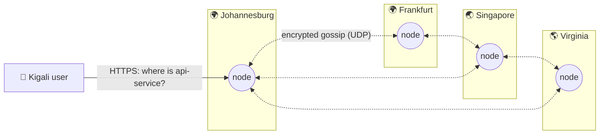
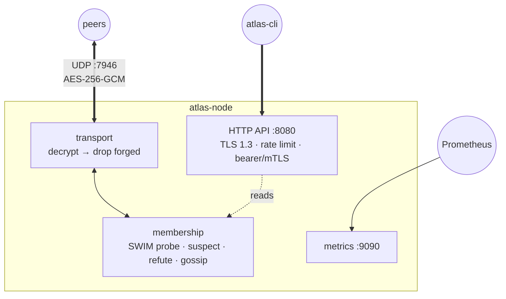

<div align="center">


# Atlas

**A distributed edge service-discovery system in Go.**
Nodes find each other through a SWIM-style gossip protocol, without a central
database or a leader. When a node dies, the rest of the cluster knows within
seconds.

[](https://github.com/manziosee/atlas/actions/workflows/ci.yml)
[](https://github.com/manziosee/atlas/actions/workflows/codeql.yml)
[](https://securityscorecards.dev/viewer/?uri=github.com/manziosee/atlas)
[](https://goreportcard.com/report/github.com/manziosee/atlas)
[](LICENSE)

</div>

---

## Table of contents

- [Why Atlas](#why-atlas)
- [Tech stack](#tech-stack)
- [Architecture](#architecture)
- [Security](#security)
- [Quick start](#quick-start)
- [Configuration](#configuration)
- [Deploy](#deploy)
- [Observability](#observability)
- [Project layout](#project-layout)
- [Roadmap](#roadmap)
- [Contributing](#contributing)

## Why Atlas

Picture 50 servers spread across the world. Atlas does not ask a central
database where services live. Instead, **every node learns about every other
node through gossip**:

- **No single point of failure.** There is no leader, no quorum and no
  central registry.
- **Local reads.** Every lookup is answered from the node's own memory.
- **Fast failure detection.** SWIM-style randomized probing with suspicion
  and refutation.
- **Partition tolerant.** Each region keeps working during a network split
  and converges once the network heals.

The design is inspired by systems such as HashiCorp's memberlist (Lifeguard)
and Fly.io's Corrosion. Atlas is its own implementation, written from first
principles.

## Tech stack

<table>
<tr>
<td align="center" width="110"><br/><b>Go 1.26+</b><br/><sub>core runtime</sub></td>
<td align="center" width="110"><br/><b>Docker</b><br/><sub>distroless images</sub></td>
<td align="center" width="110"><br/><b>Kubernetes</b><br/><sub>StatefulSet + Kustomize</sub></td>
<td align="center" width="110"><br/><b>Fly.io</b><br/><sub>multi-region edge</sub></td>
<td align="center" width="110"><br/><b>Prometheus</b><br/><sub>metrics + alerts</sub></td>
<td align="center" width="110"><br/><b>Grafana</b><br/><sub>dashboards</sub></td>
</tr>
<tr>
<td align="center"><br/><b>TLS 1.3 / mTLS</b><br/><sub>API transport</sub></td>
<td align="center"><br/><b>GitHub Actions</b><br/><sub>CI/CD</sub></td>
<td align="center"><br/><b>Sigstore</b><br/><sub>signed releases</sub></td>
<td align="center"><br/><b>SQLite</b><br/><sub>registry (Phase 3)</sub></td>
<td align="center"><br/><b>gRPC</b><br/><sub>service API (Phase 3)</sub></td>
<td align="center"><br/><b>AES-256-GCM</b><br/><sub>gossip encryption</sub></td>
</tr>
</table>

| Layer | Technology | Why |
|-------|-----------|-----|
| Language | **Go** (stdlib-first) | Goroutines and channels fit protocol loops; one static binary. |
| Gossip transport | **UDP** + **AES-256-GCM** | Connectionless, cheap per-peer messages; authenticated encryption. |
| Control API | **net/http** (TLS 1.3, HTTP/2) | Stdlib routing (Go 1.22+ patterns), no framework attack surface. |
| Logging | **log/slog** (JSON) | Structured logs, ready for Loki/ELK. |
| Metrics | **Prometheus client_golang** | Industry standard; private registry. |
| Containers | **Distroless static, nonroot** | No shell, no package manager, UID 65532. |
| Orchestration | **Kubernetes + Kustomize**, **Fly.io Machines** | Local → cluster → global edge. |
| Supply chain | **CodeQL, govulncheck, gitleaks, Grype, Dependabot, Scorecard, Cosign, SLSA provenance, SBOM** | Every link of the chain is checked. |

**Runtime dependencies:** `prometheus/client_golang` and `golang.org/x/time`
only. Everything else is the Go standard library.

## Architecture



Each node runs the same binary with two planes:



**How failure detection works:**

1. Each node pings one random member every `PROBE_INTERVAL`.
2. If no ack arrives within `PROBE_TIMEOUT`, it marks that member **suspect**.
3. The suspicion spreads by gossip. If the suspect is alive, it **refutes** by
   raising its *incarnation number*, and the higher number always wins.
4. A suspect that does not refute within `SUSPICION_TIMEOUT` is declared
   **dead**.
5. Updates piggyback on pings and on gossip to `FANOUT` random peers, with
   periodic push-pull anti-entropy. The whole cluster converges in
   O(log n) rounds.

The full internals are in **[docs/ARCHITECTURE.md](docs/ARCHITECTURE.md)**
(state machine, sequence diagrams, wire format). The decisions are recorded
in **[docs/adr/](docs/adr/)**.

## Security

Atlas assumes the network between regions is hostile.

| Layer | Controls |
|-------|----------|
| **Gossip** | AES-256-GCM on every datagram, with forged packets dropped *before* parsing. AAD protocol binding, a replay window (`MAX_CLOCK_SKEW`) and a rotatable keyring (1 primary + 3 decrypt-only keys). Bounded sizes and member counts. |
| **API** | TLS 1.3 only, with optional mTLS and certificate hot reload. Bearer tokens are stored as SHA-256 digests and compared in constant time. Per-IP rate limiting, slowloris timeouts, header/body caps and strict security headers. |
| **Config** | Fails closed: no gossip key, no tokens, weak tokens, or production without TLS each stop startup. Secrets never appear in logs. |
| **Container** | Distroless, non-root, read-only root FS, `cap_drop: ALL`, `no-new-privileges`, resource limits, ports bound to localhost in compose. |
| **Kubernetes** | Pod Security `restricted`, default-deny NetworkPolicies, no SA token, seccomp `RuntimeDefault`, PDB, topology spread. |
| **Supply chain** | CodeQL, govulncheck, gitleaks, a Grype CVE gate, Dependabot and OpenSSF Scorecard. Releases are signed with **Cosign** (keyless) and ship with an **SBOM** and **SLSA provenance**. |

The threat model, known limitations and how to report a vulnerability are in
**[SECURITY.md](SECURITY.md)**.

## Quick start

**Prerequisites:** Docker (with Compose v2), Go 1.26+ (for local builds),
OpenSSL and Bash (Git Bash works on Windows).

```bash
git clone https://github.com/manziosee/atlas && cd atlas

# 1. Create .env with freshly generated secrets (gossip key, API token, Grafana password)
./scripts/gen-secrets.sh

# 2. Start a 3-node cluster with Prometheus and Grafana
docker compose up --build -d

# 3. Ask any node about the cluster
export $(grep -E '^ATLAS_TOKEN=' .env)
docker compose exec atlas-1 atlas-cli members --addr http://127.0.0.1:8080 --token "$ATLAS_TOKEN"
```

```
ID       ADDRESS       REGION  STATE  INCARNATION    SINCE
atlas-1  atlas-1:7946  local   alive  1792277220551  42s
atlas-2  atlas-2:7946  local   alive  1792277220551  41s
atlas-3  atlas-3:7946  local   alive  1792277220550  41s
```

```bash
# 4. Break something and watch the cluster heal
./scripts/chaos.sh 3
```

| Service | URL |
|---------|-----|
| Node APIs | http://127.0.0.1:8081 · :8082 · :8083 |
| Prometheus | http://127.0.0.1:9091 |
| Grafana | http://127.0.0.1:3000 (user `admin`, password in `.env`) |

**Turn on TLS locally:**

```bash
./scripts/gen-certs.sh                       # local CA + server/client certs
# in .env: ATLAS_TLS_ENABLED=true, ATLAS_HEALTHCHECK_ADDR=https://127.0.0.1:8080
docker compose up -d
atlas-cli members --addr https://127.0.0.1:8081 --ca deploy/certs/ca.crt
```

**Without Docker:**

```bash
make build && make test
ATLAS_GOSSIP_KEY=$(./bin/atlas-cli keygen) ATLAS_API_TOKENS=$(./bin/atlas-cli tokengen) ./bin/atlas-node
```

## Configuration

All settings are environment variables with the `ATLAS_` prefix. The
annotated reference is **[.env.example](.env.example)**. The most important
ones:

| Variable | Default | Description |
|----------|---------|-------------|
| `ATLAS_ENV` | `development` | `production` enforces TLS. |
| `ATLAS_NODE_ID` | hostname | Unique node name. |
| `ATLAS_REGION` | `local` / `FLY_REGION` | Used for region-aware routing. |
| `ATLAS_SEEDS` | — | `host:port` list; DNS names may resolve to many nodes. |
| `ATLAS_GOSSIP_KEY` 🔒 | **required** | base64 256-bit key (`atlas-cli keygen`). |
| `ATLAS_GOSSIP_KEYS_SECONDARY` 🔒 | — | Decrypt-only keys for rotation. |
| `ATLAS_API_TOKENS` 🔒 | **required** | Comma-separated, ≥ 32 chars (`atlas-cli tokengen`). |
| `ATLAS_TLS_ENABLED` | `false` | HTTPS for the API (TLS 1.3). |
| `ATLAS_TLS_CLIENT_AUTH` | `false` | Require client certificates (mTLS). |
| `ATLAS_PROBE_INTERVAL` / `_TIMEOUT` | `1s` / `500ms` | Failure-detector timing. |
| `ATLAS_SUSPICION_TIMEOUT` | `5s` | Time a suspect has to refute. |
| `ATLAS_GOSSIP_INTERVAL` / `_FANOUT` | `200ms` / `3` | Dissemination speed. |

**Rotating the gossip key without downtime:**

1. Add the new key to `ATLAS_GOSSIP_KEYS_SECONDARY` on all nodes and roll them.
2. Swap: set the new key as `ATLAS_GOSSIP_KEY` and the old one as secondary,
   then roll.
3. Remove the old key and roll.

## Deploy

### Kubernetes

```bash
cp deploy/k8s/overlays/dev/secrets.env.example deploy/k8s/overlays/dev/secrets.env
# fill it with: atlas-cli keygen / atlas-cli tokengen
docker build -t atlas:dev .
kubectl apply -k deploy/k8s/overlays/dev
kubectl -n atlas get pods -w
kubectl -n atlas exec atlas-0 -- atlas-cli members --token "$TOKEN"
```

The `production` overlay adds cert-manager TLS, 5 replicas, a pinned image
and HTTPS probes. It needs cert-manager and a `ClusterIssuer` named
`atlas-ca-issuer`.

### Fly.io (multi-region)

```bash
fly apps create atlas-edge
fly secrets set -a atlas-edge ATLAS_GOSSIP_KEY="$(atlas-cli keygen)" ATLAS_API_TOKENS="$(atlas-cli tokengen)"
fly deploy --config deploy/fly/fly.toml --dockerfile Dockerfile
fly scale count 4 --region jnb,fra,sin,iad -a atlas-edge
```

Nodes discover each other through `atlas-edge.internal` DNS over Fly's
private WireGuard network. Gossip is never exposed to the internet.

## Observability

- **Metrics** (`:9090/metrics`): members by state, probe RTT histogram, probe
  timeouts, state transitions, refutations, packets and bytes, rejected
  packets by reason (`decrypt`, `decode`, `clock_skew`, `backpressure`),
  HTTP requests and latency, Go runtime.
- **Alerts** ([deploy/prometheus/alerts.yml](deploy/prometheus/alerts.yml)):
  node down, dead members, membership disagreement, a high probe-timeout
  rate, **forged gossip packets**, replay/clock skew, API auth failures.
- **Dashboard:** "Atlas — Cluster Overview" is provisioned in Grafana
  automatically.
- **Logs:** JSON via `slog`, with `X-Request-Id` on every API response.

## Project layout

```
atlas/
├── cmd/
│   ├── atlas-node/         # the node daemon
│   └── atlas-cli/          # operator CLI (members, health, keygen, tokengen)
├── internal/
│   ├── api/                # HTTP routes + middleware chain
│   ├── config/             # env config, fail-closed validation
│   ├── membership/         # SWIM failure detector + state machine
│   ├── transport/          # encrypted UDP
│   ├── security/           # keyring, TLS/mTLS, auth, rate limit, headers
│   ├── metrics/            # Prometheus collectors
│   ├── logging/ version/
│   ├── gossip/             # Phase 2: app-state broadcast, CRDTs
│   ├── routing/            # Phase 4: consistent hashing, latency routing
│   └── storage/            # Phase 3: SQLite registry
├── web/                    # Phase 5: live dashboard
├── deploy/
│   ├── k8s/                # Kustomize base + dev/production overlays
│   ├── fly/                # Fly.io multi-region config
│   ├── prometheus/         # scrape config + alert rules
│   ├── grafana/            # provisioned datasource + dashboard
│   └── certs/              # generated local certs (git-ignored)
├── docs/                   # architecture, ADRs, assets
├── scripts/                # gen-secrets, gen-certs, chaos
├── .github/                # CI, CodeQL, Scorecard, release, Dependabot
├── Dockerfile  compose.yaml  Makefile  .env.example
└── SECURITY.md  CONTRIBUTING.md  LICENSE
```

## Roadmap

- [x] **Infra & security foundation:** encrypted transport, hardened API,
  CI/CD, containers, K8s, Fly.io
- [x] **Phase 1, membership:** join, probe, suspect, refute, dead, leave
- [ ] **Phase 2, gossip:** indirect probes (`ping-req`), broadcast queue with
  retransmit limits, TCP push-pull
- [ ] **Phase 3, service registry:** advertise/lookup services, SQLite
  persistence, gRPC API
- [ ] **Phase 4, health-aware routing:** latency (EWMA RTT), region affinity,
  nearest healthy node
- [ ] **Phase 5, dashboard:** live cluster graph, gossip events, latency map
- [ ] **Stretch:** consistent hashing, CRDT state, chaos suite, global Fly.io
  demo

## Contributing

Read [CONTRIBUTING.md](CONTRIBUTING.md). Architecture changes need an
[ADR](docs/adr/0000-template.md). Report security issues privately: see
[SECURITY.md](SECURITY.md).

## License

[Apache 2.0](LICENSE)
