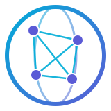
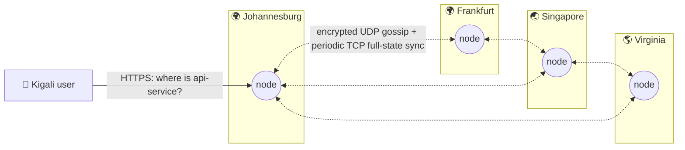

<div align="center">



# Atlas

**A distributed edge service-discovery system in Go.**
Nodes find each other through a SWIM-style gossip protocol, without a central
database or a leader. When a node dies, the rest of the cluster knows within
seconds.

[](https://github.com/manziosee/atlas/actions/workflows/ci.yml)
[](https://github.com/manziosee/atlas/actions/workflows/codeql.yml)
[](https://securityscorecards.dev/viewer/?uri=github.com/manziosee/atlas)
[](https://goreportcard.com/report/github.com/manziosee/atlas)
[](LICENSE)

</div>

---

## Table of contents

- [Why Atlas](#why-atlas)
- [Tech stack](#tech-stack)
- [Architecture](#architecture)
- [Security](#security)
- [Quick start](#quick-start)
- [Configuration](#configuration)
- [Deploy](#deploy)
- [Observability](#observability)
- [Project layout](#project-layout)
- [Roadmap](#roadmap)
- [Contributing](#contributing)

## Why Atlas

Picture 50 servers spread across the world. Atlas does not ask a central
database where services live. Instead, **every node learns about every other
node through gossip**:

- **No single point of failure.** There is no leader, no quorum and no
  central registry.
- **Local reads.** Every lookup is answered from the node's own memory.
- **Fast failure detection.** SWIM-style randomized probes, indirect
  `ping-req` checks, suspicion and refutation.
- **Partition tolerant.** Each region keeps working during a network split
  and converges once the network heals.

The design is inspired by systems such as HashiCorp's memberlist (Lifeguard)
and Fly.io's Corrosion. Atlas is its own implementation, written from first
principles.

## Tech stack

<table>
<tr>
<td align="center" width="110"><br/><b>Go 1.26+</b><br/><sub>core runtime</sub></td>
<td align="center" width="110"><br/><b>Docker</b><br/><sub>distroless images</sub></td>
<td align="center" width="110"><br/><b>Kubernetes</b><br/><sub>StatefulSet + Kustomize</sub></td>
<td align="center" width="110"><br/><b>Fly.io</b><br/><sub>multi-region edge</sub></td>
<td align="center" width="110"><br/><b>Prometheus</b><br/><sub>metrics + alerts</sub></td>
<td align="center" width="110"><br/><b>Grafana</b><br/><sub>dashboards</sub></td>
</tr>
<tr>
<td align="center"><br/><b>TLS 1.3 / mTLS</b><br/><sub>API transport</sub></td>
<td align="center"><br/><b>GitHub Actions</b><br/><sub>CI/CD</sub></td>
<td align="center"><br/><b>Sigstore</b><br/><sub>signed releases</sub></td>
<td align="center"><br/><b>SQLite</b><br/><sub>persistent service registry</sub></td>
<td align="center"><br/><b>gRPC</b><br/><sub>service registry API</sub></td>
<td align="center"><br/><b>AES-256-GCM</b><br/><sub>gossip encryption</sub></td>
</tr>
</table>

| Layer | Technology | Why |
|-------|-----------|-----|
| Language | **Go** (stdlib-first) | Goroutines and channels fit protocol loops; one static binary. |
| Gossip transport | **UDP** + **AES-256-GCM** | Connectionless, cheap per-peer messages; authenticated encryption. |
| Control API | **net/http** (TLS 1.3, HTTP/2) | Stdlib routing (Go 1.22+ patterns), no framework attack surface. |
| Logging | **log/slog** (JSON) | Structured logs, ready for Loki/ELK. |
| Metrics | **Prometheus client_golang** | Industry standard; private registry. |
| Containers | **Distroless static, nonroot** | No shell, no package manager, UID 65532. |
| Orchestration | **Kubernetes + Kustomize**, **Fly.io Machines** | Local → cluster → global edge. |
| Supply chain | **CodeQL, govulncheck, gitleaks, Grype, Dependabot, Scorecard, Cosign, SLSA provenance, SBOM** | Every link of the chain is checked. |

**Runtime dependencies:** Prometheus client, `golang.org/x/time`, gRPC, and
pure-Go SQLite (`modernc.org/sqlite`). The remaining application code uses the
Go standard library.

## Architecture



Each node runs the same binary with two planes:


**How failure detection works:**

1. Each node pings one random member every `PROBE_INTERVAL`.
2. If the direct ping does not get an ack during the first half of
   the current local-health-adjusted deadline, the node asks up to three other
   alive members to ping the target (`ping-req`). The helper forwards the
   target's ack back to the requester. The target is marked **suspect** only
   if neither direct nor indirect probing succeeds before that deadline.
   Missed probes raise a bounded local health score and lengthen later
   deadlines up to 9x `PROBE_TIMEOUT`; successful probes lower the score.
3. The suspicion spreads by gossip. If the suspect is alive, it **refutes** by
   raising its *incarnation number*, and the higher number always wins.
4. A suspect that does not refute within `SUSPICION_TIMEOUT` is declared
   **dead**.
5. Updates piggyback on pings and on gossip to `FANOUT` random peers, with
   periodic authenticated TCP push-pull of the full membership view every
   tenth gossip round. UDP gossip stays MTU-bounded; TCP sync accepts at most
   16 MiB per encrypted snapshot. This lets late joiners and recovering
   partitions reconcile views larger than a datagram.

The full internals are in **[docs/ARCHITECTURE.md](docs/ARCHITECTURE.md)**
(state machine, sequence diagrams, wire format). The decisions are recorded
in **[docs/adr/](docs/adr/)**.

## Security

Atlas assumes the network between regions is hostile.

| Layer | Controls |
|-------|----------|
| **Gossip** | AES-256-GCM on every datagram, with forged packets dropped *before* parsing. AAD protocol binding, a replay window (`MAX_CLOCK_SKEW`) and a rotatable keyring (1 primary + 3 decrypt-only keys). Bounded sizes and member counts. |
| **API** | TLS 1.3 only, with optional mTLS and certificate hot reload. Bearer tokens are stored as SHA-256 digests and compared in constant time. Per-IP rate limiting honors forwarded client addresses only from configured trusted proxy CIDRs. Slowloris timeouts, header/body caps and strict security headers. |
| **Config** | Fails closed: no gossip key, no tokens, weak tokens, or production without TLS each stop startup. Secrets never appear in logs. |
| **Container** | Distroless, non-root, read-only root FS, `cap_drop: ALL`, `no-new-privileges`, resource limits, ports bound to localhost in compose. |
| **Kubernetes** | Pod Security `restricted`, default-deny NetworkPolicies, no SA token, seccomp `RuntimeDefault`, PDB, topology spread. |
| **Supply chain** | CodeQL, govulncheck, gitleaks, a Grype CVE gate, Dependabot and OpenSSF Scorecard. Releases are signed with **Cosign** (keyless) and ship with an **SBOM** and **SLSA provenance**. |

The threat model, known limitations and how to report a vulnerability are in
**[SECURITY.md](SECURITY.md)**.

## Quick start

**Prerequisites:** Docker (with Compose v2), Go 1.26+ (for local builds),
OpenSSL and Bash (Git Bash works on Windows).

```bash
git clone https://github.com/manziosee/atlas && cd atlas

# 1. Create .env with freshly generated secrets (gossip key, API token, Grafana password)
./scripts/gen-secrets.sh

# 2. Start a 3-node cluster with Prometheus and Grafana
docker compose up --build -d

# 3. Ask any node about the cluster
export $(grep -E '^ATLAS_TOKEN=' .env)
docker compose exec atlas-1 atlas-cli members --addr http://127.0.0.1:8080 --token "$ATLAS_TOKEN"
```

```
ID       ADDRESS       REGION  STATE  INCARNATION    SINCE
atlas-1  atlas-1:7946  local   alive  1792277220551  42s
atlas-2  atlas-2:7946  local   alive  1792277220551  41s
atlas-3  atlas-3:7946  local   alive  1792277220550  41s
```

```bash
# 4. Break something and watch the cluster heal
./scripts/chaos.sh 3

# 5. Run the authenticated API load profile (30 seconds by default)
docker compose --profile loadtest run --rm k6

# 6. Register a demo instance and query it through DNS (requires `dig`)
curl -fsS -H "Authorization: Bearer $ATLAS_TOKEN" \
  -H 'Content-Type: application/json' \
  -d '{"name":"demo","address":"10.0.0.25:8080"}' \
  http://127.0.0.1:8081/v1/services
dig @127.0.0.1 -p 5353 demo.atlas A
dig @127.0.0.1 -p 5353 _demo._tcp.atlas SRV
```

| Service | URL |
|---------|-----|
| Node HTTP APIs | http://127.0.0.1:8081 · :8082 · :8083 |
| Node gRPC APIs | 127.0.0.1:8084 · :8085 · :8086 |
| Prometheus | http://127.0.0.1:9091 |
| Grafana | http://127.0.0.1:3000 (user `admin`, password in `.env`) |

**Turn on TLS locally:**

```bash
./scripts/gen-certs.sh                       # local CA + server/client certs
# in .env: ATLAS_TLS_ENABLED=true, ATLAS_HEALTHCHECK_ADDR=https://127.0.0.1:8080
docker compose up -d
atlas-cli members --addr https://127.0.0.1:8081 --ca deploy/certs/ca.crt
```

### Service registry API

All `/v1/*` endpoints require a bearer credential. Read endpoints require the
`read` scope; registration and deletion require `write`; `admin` grants both.
Scoped credentials may have an RFC3339 `expires_at`; expired credentials are
rejected. The compatibility `ATLAS_API_TOKENS` setting grants unexpired admin
credentials, so use `ATLAS_API_CREDENTIALS` for least privilege. Each node
persists its own registrations in SQLite and replicates service records over
membership gossip. A registration belongs to the node that accepted it;
health checks and deletion are performed by that owner.

| Method and path | Purpose |
|-----------------|---------|
| `POST /v1/services` | Register an instance (`name`, `address`, optional `version`, `tags`, `health_check`). |
| `GET /v1/services?name=&region=&health=` | Find active instances, optionally filtered. |
| `GET /v1/services/{id}` | Read an instance. |
| `DELETE /v1/services/{id}` | Delete an instance through its owner node. |
| `GET /v1/events` | Stream membership events as Server-Sent Events. |

Open `http://127.0.0.1:8081/dashboard/` for the embedded live cluster view.
The dashboard asks for a bearer token and holds it in page memory while it
loads members and services and listens for membership events.

`GET /v1/lookup/{name}?region=...&key=...` selects a healthy instance, preferring
the requested region. Unknown-health instances are fallback candidates only
when no healthy instance exists. A key enables consistent hashing; without a
key, candidates are selected round-robin. Unhealthy instances are never returned.

The same registry operations are available on the gRPC listener configured by
`ATLAS_GRPC_ADDR`; the service definition is in [`api/v1/registry.proto`](api/v1/registry.proto).
Use `atlas-cli services --output json` or `atlas-cli lookup NAME --key customer-17` to query
registrations, and `atlas-cli watch` to stream membership events. SQLite
snapshots can be created and restored with the storage package's
`Store.Backup` and `storage.Restore` APIs.

### DNS discovery

The node can optionally serve DNS over UDP and TCP. Compose enables it on
`127.0.0.1:5353`; standalone deployments leave it disabled unless
`ATLAS_DNS_ADDR` is set. DNS has no authentication, so bind it only to a
private network or put an access-controlled DNS forwarder in front of it.
Queries return up to eight healthy instances, rotating the answer set across
larger pools. If none are healthy, unknown-health instances are returned.
Unhealthy and deleted instances are never returned. The default TTL is five
seconds. DNS carries no record freshness timestamp; the TTL only controls DNS
caching. Use `GET /v1/services` to inspect each record's `updated_at` value.

| Query | Result |
|-------|--------|
| `payments.atlas. A` / `AAAA` | Matching eligible IPv4 / IPv6 addresses |
| `_payments._tcp.atlas. SRV` | Instance targets and registered ports |
| `payments.eu.atlas. A` | Instances in the `eu` region |
| `_payments._tcp.eu.atlas. SRV` | SRV instances in the `eu` region |

SRV answers for IP-addressed instances include stable Atlas target names and
address glue; those target names also resolve back to the instance address.
Hostname-addressed instances use their registered hostname as the target. DNS
service names and regions must each fit one DNS label (1-63 characters); names
containing dots remain available through the HTTP API. DNS reads each node's
local registry replica; answers converge through Atlas gossip. Set
`ATLAS_DNS_ADDR=0.0.0.0:5353`,
`ATLAS_DNS_ZONE=atlas`, and `ATLAS_DNS_TTL=5s` to enable it. Applications can
use a custom DNS port by pointing a resolver or CoreDNS forward rule at Atlas.

### Python client

The standard-library-only client supports bearer auth, custom CA roots, and
optional mTLS:

```bash
python -m pip install ./clients/python
```

```python
from atlas import AtlasClient

client = AtlasClient("https://atlas.example:8080", token="...", ca_file="ca.crt")
instance = client.lookup("payments", region="eu", key="customer-17")
print(instance["address"])
```

The CLI accepts connection defaults from `ATLAS_CLI_CONFIG`, a JSON file with
`addr`, `token`, `ca_file`, `client_cert`, and `client_key` fields. Environment
variables and command flags override file values. Protect the file as a secret
because it may contain the bearer token; use `ATLAS_TOKEN` when you want the
token kept outside the file.

The public Go client lives at `github.com/manziosee/atlas/pkg/atlas`:

```go
client, err := atlas.NewClient("https://atlas.example", token, httpClient)
if err != nil { return err }
instance, err := client.Lookup(ctx, "payments", "jnb", "customer-17")
```

Generate command completion with `atlas-cli completion bash`, `zsh`, `fish`,
or `powershell`, then load the printed script in the matching shell.

**Without Docker:**

```bash
make build && make test
ATLAS_GOSSIP_KEY=$(./bin/atlas-cli keygen) ATLAS_API_TOKENS=$(./bin/atlas-cli tokengen) ./bin/atlas-node
```

**Membership scale benchmark:**

```bash
make bench-scale
```

The in-process simulator checks full-view convergence at 100, 500, and 1,000
nodes using the production membership handlers, bounded UDP gossip, and TCP
push-pull semantics over a lossless fake transport. Results include
`convergence-ms`; CI uploads each run.

One local run on Windows/amd64 with an Intel Core i5-8350U at 1.70 GHz
(2026-10-20):

| Nodes | Full-view convergence |
|-------|-----------------------|
| 100 | 1.99 s |
| 500 | 26.78 s |
| 1,000 | 75.22 s |

These are single-run in-process measurements over a lossless simulated
transport. They measure gossip scheduling and membership merge costs, not
socket framing, AEAD CPU, network latency, packet loss, or cross-region links.
The 1,000-node run reached approximately 1.2 GiB peak process memory on this
host.

## Configuration

All settings are environment variables with the `ATLAS_` prefix. The
annotated reference is **[.env.example](.env.example)**. The most important
ones:

The node can also load a `KEY=value` file selected by `ATLAS_CONFIG_FILE`.
Non-empty environment values override file entries. Keep this file private
when it contains gossip keys or API tokens. TLS certificates already reload
automatically. Send `SIGHUP` to reload gossip keys, API tokens, node admission,
rate limits, trusted proxies, and log level. Listener, node identity, database,
TLS mode, and timing changes require a restart.

| Variable | Default | Description |
|----------|---------|-------------|
| `ATLAS_ENV` | `development` | `production` enforces TLS. |
| `ATLAS_NODE_ID` | hostname | Unique node name. |
| `ATLAS_REGION` | `local` / `FLY_REGION` | Used for region-aware routing. |
| `ATLAS_SEEDS` | — | `host:port` list; DNS names may resolve to many nodes. |
| `ATLAS_ALLOWED_NODE_IDS` | empty | Optional comma-separated node-ID admission allowlist; each node must list itself. |
| `ATLAS_GOSSIP_KEY` 🔒 | **required** | base64 256-bit key (`atlas-cli keygen`). |
| `ATLAS_GOSSIP_KEYS_SECONDARY` 🔒 | — | Decrypt-only keys for rotation. |
| `ATLAS_API_TOKENS` 🔒 | one credential option | Comma-separated legacy tokens, ≥ 32 chars; grant full API access without expiry. |
| `ATLAS_API_CREDENTIALS` 🔒 | one credential option | JSON array of `{token, scopes, expires_at}`; scopes are `read`, `write`, `admin`; expiry is required RFC3339. |
| `ATLAS_TLS_ENABLED` | `false` | HTTPS for the API (TLS 1.3). |
| `ATLAS_GRPC_ADDR` | `0.0.0.0:8082` | gRPC listener using the same TLS and bearer-token settings. |
| `ATLAS_PPROF_ADDR` | `127.0.0.1:6060` | Local-only Go pprof listener; configuration rejects non-loopback bind addresses. |
| `ATLAS_TRUSTED_PROXIES` | empty | Comma-separated CIDRs allowed to supply `X-Forwarded-For` client addresses. |
| `ATLAS_DB_PATH` | `data/atlas.db` | Per-node SQLite file for service registry persistence. |
| `ATLAS_HEALTH_CHECK_INTERVAL` / `_TIMEOUT` | `5s` / `1s` | Probe interval and deadline for registered HTTP checks. |
| `ATLAS_TLS_CLIENT_AUTH` | `false` | Require client certificates (mTLS). |
| `ATLAS_PROBE_INTERVAL` / `_TIMEOUT` | `1s` / `500ms` | Failure-detector timing. |
| `ATLAS_SUSPICION_TIMEOUT` | `5s` | Time a suspect has to refute. |
| `ATLAS_GOSSIP_INTERVAL` / `_FANOUT` | `200ms` / `3` | Dissemination speed. |

**Rotating the gossip key without downtime:**

1. Add the new key to `ATLAS_GOSSIP_KEYS_SECONDARY` on all nodes and signal
   each node with `SIGHUP` (or roll them).
2. Swap: set the new key as `ATLAS_GOSSIP_KEY` and the old one as secondary,
   then signal all nodes again.
3. Remove the old key and signal all nodes a final time.

## Deploy

### Kubernetes

```bash
cp deploy/k8s/overlays/dev/secrets.env.example deploy/k8s/overlays/dev/secrets.env
# fill it with: atlas-cli keygen / atlas-cli tokengen
docker build -t atlas:dev .
kubectl apply -k deploy/k8s/overlays/dev
kubectl -n atlas get pods -w
kubectl -n atlas exec atlas-0 -- atlas-cli members --token "$TOKEN"
```

The `production` overlay adds cert-manager TLS, 5 replicas, a pinned image
and HTTPS probes. It needs cert-manager and a `ClusterIssuer` named
`atlas-ca-issuer`.

The `atlas` ClusterIP service exposes Atlas DNS on port 5353 over UDP and TCP.
It serves registry records under `atlas.`; clients can query it directly or
configure a private CoreDNS forward rule. The NetworkPolicy limits DNS access
to the Atlas namespace and namespaces labeled `atlas.io/api-access: "true"`.
This publishes Atlas registrations to Kubernetes clients; it does not import
Kubernetes Services into Atlas.

Clusters using Prometheus Operator can install the optional scrape and alert
resources after its CRDs are available:

```bash
kubectl apply -k deploy/k8s/monitoring
```

**SQLite snapshots:** `atlas-cli db-backup -output ./atlas-backup.db` creates a
consistent snapshot while the node is running. Restore to a new path with
`atlas-cli db-restore -input ./atlas-backup.db -db ./atlas-restored.db`. The
restore command checks SQLite integrity and refuses to overwrite an existing
file. Stop the node before replacing its active database, and move the live
database plus any `-wal`/`-shm` files aside before restoring to the original
path.

### Fly.io (multi-region)

The root `fly.toml` is a single-region starting point for an app created with
`fly launch` (the current `atlas-edge` app is in `cdg`). Create a region-local
`atlas_data` volume and configure the two required secrets before deploying.
Scale to one Machine for this initial setup; add a volume for every additional
Machine. The multi-region example below uses `deploy/fly/fly.toml` instead.

```bash
fly apps create atlas-edge
fly secrets set -a atlas-edge ATLAS_GOSSIP_KEY="$(atlas-cli keygen)" ATLAS_API_TOKENS="$(atlas-cli tokengen)"
# Create one same-named, region-local volume for every Machine before deploy.
fly volumes create atlas_data --region jnb --size 1
fly volumes create atlas_data --region fra --size 1
fly volumes create atlas_data --region sin --size 1
fly volumes create atlas_data --region iad --size 1
fly deploy --config deploy/fly/fly.toml --dockerfile Dockerfile
fly scale count 4 --region jnb,fra,sin,iad -a atlas-edge
```

Nodes discover each other through `atlas-edge.internal` DNS over Fly's
private WireGuard network. Gossip is never exposed to the internet.
Each Machine mounts its own `/data` volume; Atlas replicates registry records
between nodes. Volumes are local to a Machine and do not replicate by
themselves. Create additional `atlas_data` volumes in a region before scaling
that region beyond one Machine, and keep independent database backups.

## Observability

- **Metrics** (`:9090/metrics`): members by state, Lifeguard local health score,
  probe RTT histogram and
  per-peer EWMA RTT gauges, probe
  timeouts, state transitions, refutations, packets and bytes, rejected
  packets by reason (`decrypt`, `decode`, `clock_skew`, `backpressure`, `admission`, `oversize`),
  HTTP requests and latency, DNS query counts by type/response code, malformed
  DNS messages, Go runtime.
- **Alerts** ([deploy/prometheus/alerts.yml](deploy/prometheus/alerts.yml)):
  node down, dead members, membership disagreement, a high probe-timeout
  rate, **forged gossip packets**, replay/clock skew, API auth failures.
- **Dashboard:** "Atlas — Cluster Overview" is provisioned in Grafana
  automatically.
- **Logs:** JSON via `slog`, with `X-Request-Id` on every API response.
- **Audit trail:** HTTP and gRPC access logs include operation, result,
  source address, and a non-secret token fingerprint; bearer values are never logged.

## Project layout

```
atlas/
├── cmd/
│   ├── atlas-node/         # the node daemon
│   └── atlas-cli/          # operator CLI (members, health, keygen, tokengen)
├── internal/
│   ├── api/                # HTTP routes + middleware chain
│   ├── config/             # env config, fail-closed validation
│   ├── membership/         # SWIM failure detector + state machine
│   ├── transport/          # encrypted UDP
│   ├── security/           # keyring, TLS/mTLS, auth, rate limit, headers
│   ├── metrics/            # Prometheus collectors
│   ├── logging/ version/
│   ├── gossip/             # Phase 2: app-state broadcast, CRDTs
│   ├── routing/            # healthy-instance selection, region affinity, consistent hashing
│   └── storage/            # Phase 3: SQLite registry
├── web/                    # Phase 5: live dashboard
├── deploy/
│   ├── k8s/                # Kustomize base + dev/production overlays
│   ├── fly/                # Fly.io multi-region config
│   ├── prometheus/         # scrape config + alert rules
│   ├── grafana/            # provisioned datasource + dashboard
│   └── certs/              # generated local certs (git-ignored)
├── docs/                   # architecture, ADRs, assets
├── scripts/                # gen-secrets, gen-certs, chaos
├── .github/                # CI, CodeQL, Scorecard, release, Dependabot
├── Dockerfile  compose.yaml  Makefile  .env.example
└── SECURITY.md  CONTRIBUTING.md  LICENSE
```

## Roadmap

- [x] **Infra & security foundation:** encrypted transport, hardened API,
  CI/CD, containers, K8s, Fly.io
- [x] **Phase 1, membership:** join, probe, suspect, refute, dead, leave
- [x] **Phase 2, indirect probes:** direct checks fall back to up to three
  helper nodes, which relay acknowledgments.
- [x] **Phase 2, bounded dissemination:** member changes use a bounded queue
  with cluster-sized retransmission limits.
- [x] **Phase 2, Lifeguard local health:** repeated missed probes extend the
  local probe deadline up to 9x the configured timeout; successful probes
  reduce the score.
- [x] **Phase 2, TCP push-pull:** authenticated length-prefixed full membership
  snapshots over TCP every tenth gossip round; UDP updates remain MTU-bounded.
- [x] **Phase 2 follow-up:** versioned protobuf wire format for gossip and TCP
  push-pull, with a legacy JSON receive path during upgrades (`api/v1/gossip.proto`).
- [x] **Phase 3, service registry foundation:** HTTP and gRPC register/list/get/delete,
  SQLite persistence, owner health checks, gossip replication, CLI lookup, SSE events,
  and snapshot backup/restore.
- [ ] **Phase 3 follow-up:** typed generated protobuf SDK.
- [x] **Phase 3 follow-up:** bounded registry digest repair over authenticated
  TCP push-pull, including tombstones and full snapshots capped at 100,000 rows.
- [x] **Adoption:** optional private-network DNS listener for healthy service
  A/AAAA and SRV records, with region-specific names, rotating answer sets,
  query metrics, and short configurable TTLs.
- [x] **Adoption:** standard-library-only Python client for registry CRUD and
  routing lookup (`clients/python`).
- [x] **Kubernetes integration:** Kustomize deploys expose Atlas DNS to opted-in
  namespaces; importing native Kubernetes Services still needs a controller.
- [ ] **Adoption follow-up:** Java/Node clients, service-history API, and
  configurable stale-record and latency-routing policies.
- [x] **Phase 4, health-aware routing:** healthy instances, region affinity,
  per-peer EWMA probe latency, nearest measured instance, consistent hashing,
  and round-robin fallback.
- [x] **Phase 5, dashboard foundation:** embedded live member/service tables
  and authenticated membership event stream.
- [ ] **Phase 5 follow-up:** cluster graph, geographic visualization and
  latency map.
- [x] **Security operations:** optional node-ID admission allowlist, trusted
  proxy handling, TLS certificate reload, and non-secret bearer fingerprints
  in access logs.
- [x] **Security follow-up:** scoped and expiring API credentials.
- [ ] **Security follow-up:** cryptographic per-node identity, Vault integration,
  and signed update commits.
- [x] **API and SDK:** OpenAPI description, HTTP/gRPC registry endpoints,
  command-line lookup/watch, JSON output, configuration file, and public Go
  HTTP client.
- [ ] **API follow-up:** generated typed protobuf SDK and richer admin
  operations.
- [x] **Test foundation:** protocol, SQLite, HTTP/gRPC, routing, proxy, fuzz,
  and failure-detection tests run in CI.
- [x] **Test scale coverage:** 100, 500, and 1,000-node in-process convergence
  benchmark runs in CI with artifact output; Compose chaos recovery also runs in CI.
- [x] **Test follow-up:** Compose chaos CI now tests process failure and
  recovery plus a running-node network partition and reconnection.
- [x] **Test follow-up:** authenticated k6 API load profile runs in Compose CI.
- [ ] **Test follow-up:** TLS rotation end-to-end tests. CI enforces 60% total
  statement coverage; the current measured total is 63.8%.
- [x] **Deployment foundation:** Compose, Kustomize dev/production overlays,
  Prometheus/Grafana, optional Prometheus Operator resources, and a Fly config.
- [ ] **Deployment follow-up:** Helm, IaC, staged CD/GitOps, autoscaling,
  scheduled off-node database backups with restore drills, and public staging.
- [x] **Documentation:** architecture, API spec, run instructions, dashboard,
  backup/restore steps, and operator runbooks for API and membership alerts.
- [x] **Observability:** API availability and latency recording rules, SLO
  alerts, and Grafana panels for the rolling 5-minute objectives.
- [ ] **Repository operations:** release/tag creation, GitHub security settings,
  milestones, discussions, and hosted uptime page need repository access.
- [x] **Stretch:** consistent hashing is implemented in the routing package.
- [x] **Stretch follow-up:** deterministic revisioned LWW-register merge for
  replicated service records.
- [ ] **Stretch follow-up:** expanded chaos suite and global Fly.io demo.

## Contributing

Read [CONTRIBUTING.md](CONTRIBUTING.md). Architecture changes need an
[ADR](docs/adr/0000-template.md). Report security issues privately: see
[SECURITY.md](SECURITY.md).

## License

[Apache 2.0](LICENSE)
