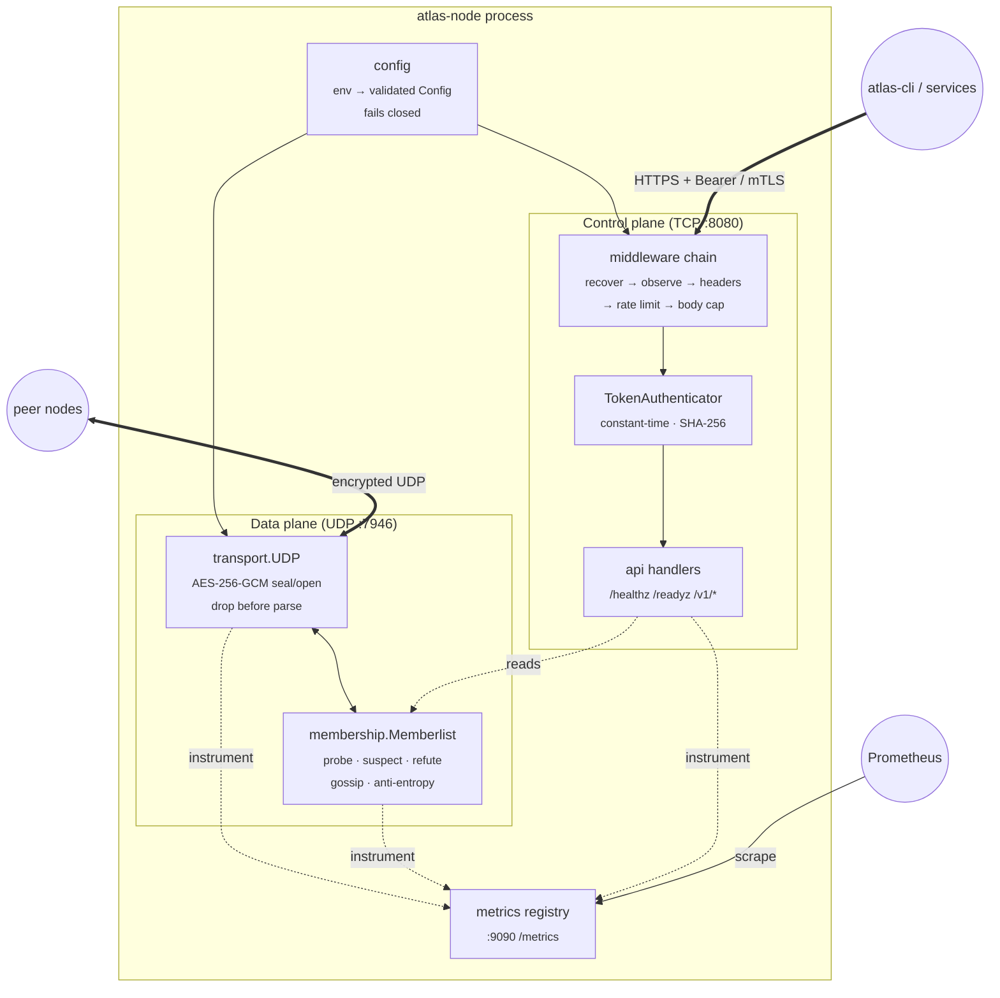
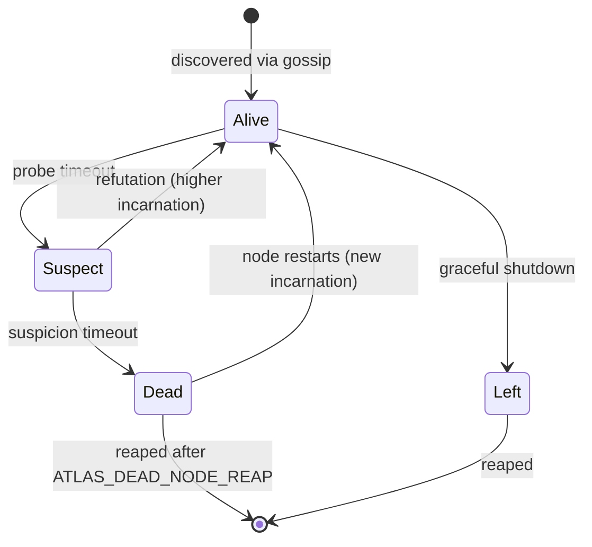
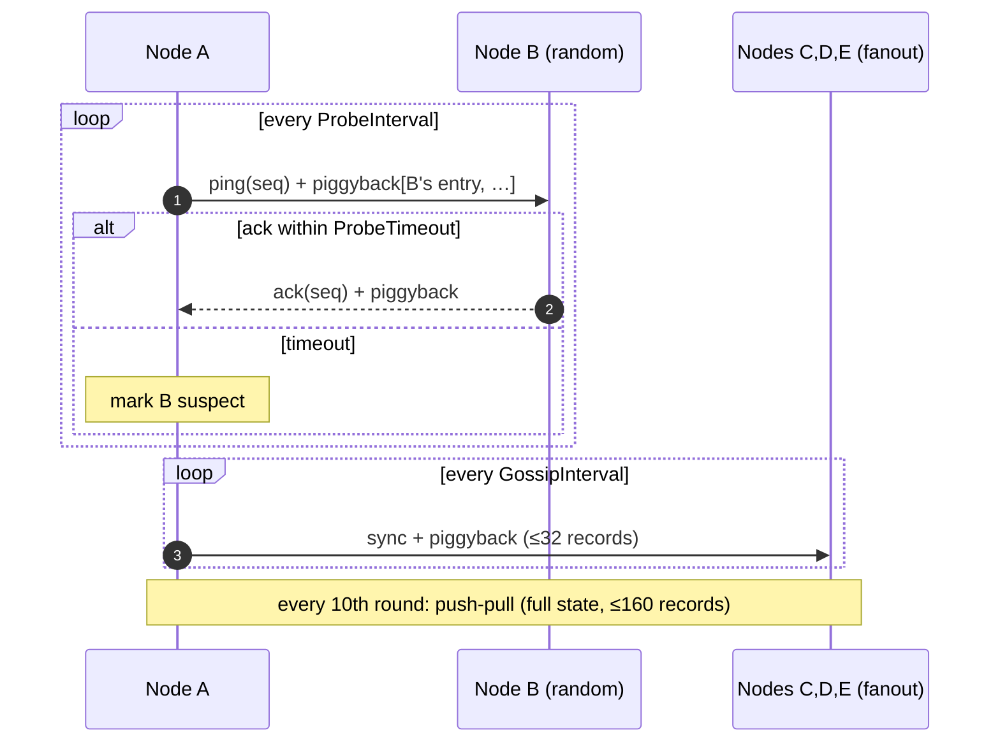
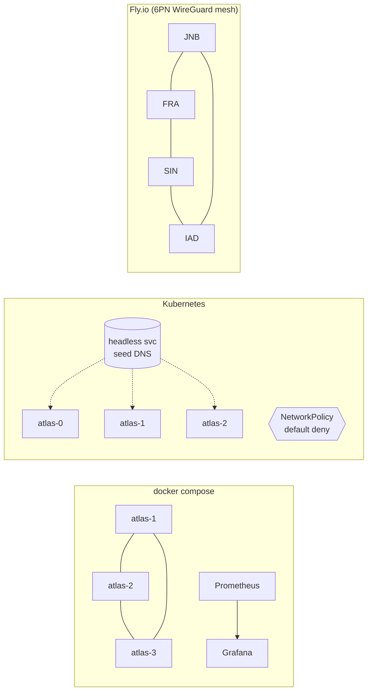

# Atlas Architecture

This document explains **how Atlas works inside**. For the why behind each
choice, see the [ADRs](adr/).

## 1. Node anatomy

Every node runs the same binary (`atlas-node`). No node is special.



| Package | Responsibility |
|---------|----------------|
| `cmd/atlas-node` | Wiring, lifecycle, graceful shutdown (SIGTERM → leave → close). |
| `cmd/atlas-cli` | Operator CLI: `members`, `node`, `health`, `keygen`, `tokengen`. |
| `internal/config` | Env parsing; reports **all** errors at once; production guards. |
| `internal/security` | Keyring, TLS/mTLS + cert hot reload, token auth, rate limiter, headers. |
| `internal/transport` | Encrypted UDP, DNS cache, advertise-address detection. |
| `internal/membership` | SWIM failure detector and member state machine. |
| `internal/api` | HTTP routes and middleware. |
| `internal/metrics` | Prometheus collectors on a private registry. |
| `internal/gossip`, `routing`, `storage` | Upcoming phases (registry, routing, SQLite). |

## 2. Membership protocol

### Member state machine



**Merge rule:** a higher incarnation always wins. With equal incarnations the
"worse" state wins (`alive < suspect < dead < left`). Only a node can raise
its own incarnation, so when it hears that it is suspected, it bumps the
number and the rumor loses. A restarted node starts its incarnation from
wall-clock milliseconds, so it always outranks its previous life.

### One protocol period



The target's own record always rides along with a ping. A suspected node
therefore learns about the suspicion at the next probe and refutes it right
away.

### Timing (defaults)

| Setting | LAN default | Fly.io (global) | Effect |
|---------|-------------|-----------------|--------|
| `ATLAS_PROBE_INTERVAL` | 1s | 2s | Detection speed vs. traffic |
| `ATLAS_PROBE_TIMEOUT` | 500ms | 1s | Must exceed worst-case RTT |
| `ATLAS_SUSPICION_TIMEOUT` | 5s | 10s | Window for refutation |
| `ATLAS_GOSSIP_INTERVAL` | 200ms | 300ms | Dissemination speed |
| `ATLAS_GOSSIP_FANOUT` | 3 | 3 | Peers per gossip round |

The worst-case time to declare a crashed node dead is about
`ProbeInterval × (n-1)` (until someone probes it) `+ ProbeTimeout +
SuspicionTimeout`. In practice it is much faster, because every node probes
independently.

## 3. Wire format

```
UDP datagram
┌─────────┬──────────────┬──────────────────────────────┬─────────┐
│ ver (1) │ nonce (12)   │ ciphertext (JSON message)    │ tag (16)│
└─────────┴──────────────┴──────────────────────────────┴─────────┘
            AES-256-GCM, AAD = "atlas/gossip/v1"

message (JSON, inside ciphertext)
{ "t": "ping|ack|sync|pull", "seq": 42, "ts": 1792277220551,
  "from": {id, addr, region, state, incarnation},
  "m":    [ …piggybacked member records… ] }
```

Receive pipeline: `read → size check → AEAD open (drop on failure) → JSON
decode → validate (lengths, states, ≤512 members) → clock-skew check →
merge`.

## 4. Deployment topologies



- **Compose:** static seeds (`atlas-1..3`), hardened containers, ports bound to
  localhost.
- **Kubernetes:** a StatefulSet seeded via the headless service DNS
  (`publishNotReadyAddresses` avoids a bootstrap deadlock), Pod Security
  `restricted`, default-deny NetworkPolicy, PDB, cert-manager TLS in
  production.
- **Fly.io:** `atlas-edge.internal` DNS lists every Machine, and nodes
  advertise `FLY_PRIVATE_IP`. Gossip stays inside the WireGuard mesh, and
  public HTTPS terminates at Fly's edge.

## 5. Roadmap hooks

| Phase | Where it lands |
|-------|----------------|
| 2 — indirect probes, broadcast queue | `membership.probe`, `internal/gossip` |
| 3 — service registry + SQLite + gRPC | `internal/storage`, `ATLAS_GRPC_ADDR` |
| 4 — consistent hashing, latency routing | `internal/routing` (RTTs from `ProbeRTT`) |
| 5 — dashboard | `web/`, SSE from `Memberlist.Events()` |
